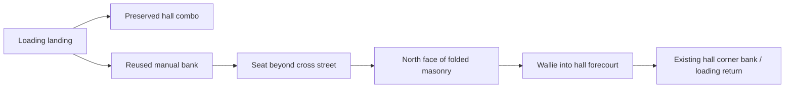

# Barras loading/hall junction — revised source proposal

**Private design only.** No geometry, native run, rendered view or production
install exists. This follows the partial topology critique and preserves its
source limitations. It is one candidate local junction, not two accepted arena
lines or a cross-arena circuit. Prove the useful existing Exchange west line
before committing to additional Barras topology work if that is lower risk.

The current loading/hall run passes west along Z−2 between two distant islands.
Reuse the isolated southern manual bank and return seat as an optional south
branch, and fold the existing southwest boundary to frame a purposeful return.
The original loading→hall combo and its north dry return remain in place.

| Retained object | Proposed placement/relationship | Exact caveat |
| --- | --- | --- |
| `barras_forecourt_line` | Centre(91,0,8), yaw−π/2. Terrain coreX89…93/Z1…15; plateauZ5…11/Y0.55; published runoutZ−3…19. | Terrain is not its entire native/display envelope. Inventory cylinder caps, guide perimeter and edge strips before claiming widths. Keep slope/height query/audio and records atomic. |
| `barras_forecourt_return` | Same10m seat translated fromX74…84/Z36 toX79…89/Z26. | Z19 was rejected: its cap would be only0.69m from old C04 landing(83,18). AtZ26 the cap starts25.69, beyond the wholeZ20…24 crossing. Finite truck/tyre contact remains unproved. |
| West `MarketSouthBoundary` only | Existing36m run folded to(50,30.8)→(72,30.8)→(72,44.8). | Select the originalX50…86 body explicitly; leave the other southern boundary and X86…102 Clyde mouth unchanged. Resample BOTH legs in2m units:18 native panels/19 points. |
| Boundary display | Investigate one MultiMesh of18 closed box panels with existing shared unitBoxMesh/material. | Generic `opaque=true` creates a new unique ArrayMesh. Shared flat orthogonal boxes can match native prisms without that increase; prove runtime interning/output. No generic graded-wall shortcut. |

The original36m fence constructor has198 metal +36 plinth box instances =234
boxes/2,808 triangles. A flat closed18-panel box display has216 triangles. These
are source constructor arithmetic, **not measured draw calls, memory or FPS**.
Retain the same native body and18 shape slots; require non-increasing resource
totals and zero new textures/materials. Do not simply change the protected55
opaque-prism expectation: this converts a separately identified iron boundary,
so any audit migration must preserve the original55 and enumerate these18.

Opaque masonry intentionally changes this body's visual/audio and wallride
eligibility. A credible initial five-metre warehouse retaining face may keep
charged routes inside, but its height is a proposal, not containment proof.
Retain support behind it until maximum naturally reached launches and supported
miss recovery are measured. The fold frames approximately308m² of surplus
southwest paving as scenery; it does not justify deleting that ground or
silently advertising a blocked route on the map.

## Actual topology to investigate

The loading landing can choose its preserved westward hall combo or a southbound
bank crossing. A bank exit then sees the transverse seat and masonry return:

The **horizontal22m wall face atZ30.8** is the promising return, not a southbound
ride toward the end of its14m vertical leg. From a westbound seat exit near
(79,26), an oblique approach toward about(67,30.8) is12.92m. It passes north of
the corner at(72,30.8) before meeting the real north-facing wall. Westward
wall travel then has room for a genuine useful ride, and a northward Wallie
returns onto the supported hall forecourt. A subsequent natural turn can feed
the real corner bank, rather than a long no-choice perimeter commute.

These coordinates are **aim hypotheses**, not forced inputs or acceptance
anchors. The actual wallride, Wallie trajectory, usable speed interval, finite
payoff, full-body chase, landing/runout and useful next capture must decide the
arrangement. Preserve a spatial line with separately audited score banks if it
cannot honestly stay one combo. No reset, per-frame heading/speed assignment,
minimum Manual reduction or combo-deadline change can make the new circuit.

## Protected work and decisive negatives

- Keep the original C04 loading drop→Manual→exact hall ledge→dry landing and
  its exactly-one-bank calculator. The X83/Z−6…18 dry return is retained.
- Preserve X103 open and X114 covered delivery aisles, their ordered Mairi
  gates, all ten career goals, loading banks/stairs, recording court and the
  Z20…24 cross street. A source centreline is not a full-width/camera proof.
- Keep the original entry along Z−2. The bank's north terrain toe atZ1 has3m
  geometric separation, but native full-width sweeps and the actual old combo
  must confirm it. Run easy bypasses in both directions.
- Prove source/display/native shape identity through every boundary corner,
  exact native wall eligibility and both sides. Test early/late entry,
  overshooting the seat, missed capture, north/south wall ends, seam shoulders,
  a low-speed stop and maximum charged departures with real inputs.
- Preserve every actual board component and shoe volume on each physics step.
  Loaded capsule contacts use the existing authenticated finite floor/wall
  contracts; no whole-owner exclusions or new tolerance. Current Station
  tyre/crest and legacy generic ledge-grounding defects are dependencies,
  not reasons to omit this gate or phase-tune the props.
- Bind both native and matched before/after chase/overview/moving captures to
  frozen source. Inspect the new wall from Clyde and Exchange approaches so
  enclosure does not conceal the next district mouth or create a blind turn.

Local ticket **FID-402-B01**, P1/F2. Owner LD with Motion for real contact,
Environment Architect for credible enclosure within the resource ceiling, and
independent QE/BA for admission. Status **source proposal / unbuilt**. Root owns
any fresh private prototype lease, controlled installation and main checkpoint.
