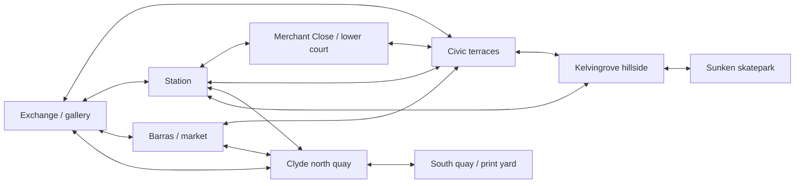

# Overall layout and combo-route recommendations

25 October 2026 · Lead level-design review · Source baseline: `cb8b9a0` on `main`.

**The sections are well connected for travel, but readable continuous combo routes
are uneven.** There are useful local lines and genuine alternate routes. Several
district entrances, long connectors and repeated small feature groups still feel
like skating opportunities placed near each other rather than deliberately joined
runs. The next pass should mostly reposition, reorient or simplify existing
geometry, with a clear entry, payoff and return for each line.

**The requested enclosed station, tunnel and passing train are not implemented.**
The playable station district exists; the new railway presentation remains
PT24-15, Planned. **No PT24 ticket is formally closed: 0 of 30.** Source repairs
have been made, but outstanding design and acceptance work remains.

This is a recommendations-only review. No game code, geometry, ticket status or
acceptance criteria were changed. No game launch or new test run was performed.

## Evidence and what it establishes

Current placements and stable IDs were read from
[`glasgow_square.gd`](../../game/levels/glasgow_square.gd),
[`fidelity_infill.gd`](../../game/levels/fidelity_infill.gd),
[`outdoor_routes.gd`](../../game/levels/outdoor_routes.gd),
[`clyde_layout.gd`](../../game/levels/clyde_layout.gd),
[`kelvingrove_skatepark.gd`](../../game/levels/kelvingrove_skatepark.gd),
[`transition_park.gd`](../../game/levels/transition_park.gd),
[`skate_edges.gd`](../../game/levels/skate_edges.gd) and
[`street_dressing.gd`](../../game/levels/art/street_dressing.gd).

The existing [repair record](../testing/pt24-repairs-2026-10-25/README.md), source
tests and older place briefs provide bounded physical evidence. In particular,
the gallery bank/turning ledge/manual, civic A/B/C challenge, individual manual
decks and south-quay flatbar approach have actual-input evidence. That does not
prove an uninterrupted combo between every district or every adjacent feature.
The density audit explicitly measures proximity, rather than pathfinding or the
reachability of every approach. The full suite's 4,657/0 result is existing
engineering evidence, not a new fun or layout acceptance result from this review.

Images inspected include current repair views 11/19/22/30 and the owner's original
25/27/28/34. Original images identify the reported design problem; the source and
current repair frames establish which geometry has subsequently changed.

Coordinates below are authored metres, with +Y up and −Z north. Source placements
are facts; suggested alignment, spacing and pacing are design proposals requiring
future native-input validation. Older [OUTDOOR-ROUTES](OUTDOOR-ROUTES.md) contains
superseded Clyde dimensions. Current bridges are at **X−25** and **X20**, not the
older X−98/X35; the north quay is X−85…85. Use the current layout source.

## Existing connectivity

The map has several loops rather than a single prescribed circuit:

These arrows show authored travel connections, not certified continuous combos.
The Clyde has a continuous safe bridge and an optional broken-bridge jump. The
station has high and low choices. The park has a hillside loop, cutback and two
city access directions. Preserve these strengths.

| Section | What already works structurally | Main missing relationship |
| --- | --- | --- |
| Exchange/gallery | Entrance banks, angled seating ledge, stair rail/drop, fountain coping and west shopfront bank | The gallery descent and fountain/south-bank choices do not read as one obvious sequence from the riding camera |
| Civic | Side banks, gardens/ledges, busking A/B/C course and broad cross-streets | The lower island, uphill/downhill routes and park mouth need clearer handoffs; the A/B/C challenge permits separate banks and does not prove one continuous combo |
| Station/Close | Platform gap and bypass, underpass, close dogleg, lower-court exits, halfpipe, spine and service gate | Individual attractions need obvious onward lines toward the city, park or quay; the train/station architectural purpose is missing |
| Barras | Covered/open aisles, two return loops, loading gap/rail/banks and hall ledge | Large approach distances and the recording-alcove walls interrupt a coherent entrance-to-landing-to-return composition |
| Clyde | Safe crossing, optional gap, bank/hip, bowl, quay coping and south relay | Bridge landings and the east/west quay lines need deliberate joins; red suspension cables are not verified grind contacts |
| Kelvingrove | Uphill/downhill loop, cutback, practice apron, graded ledges and a substantial sunken facility | Repeated seats on long paths need heading-aware placement and a clearer arrival/exit rhythm |

Continuous combos require deliberate flatland space. The current landing-link
window is **0.35 seconds**: at a proposed moderate 6–9m/s, ordinary rolling alone
uses that window in roughly 2.1–3.15m. Manuals, grinds and suitable air links can
bridge longer distances. This does **not** mean every obstacle should be 3m apart;
it means a clear, supported manual entry and continuation matter more than having
an object somewhere within the density audit's 20–35m proximity bands.

## Six recommended fixes, in order

### 1. Compose the Exchange descent and district thresholds

**Priority P1 · Level design + world geometry · Existing M03-002/M03-005/M05-001.**

Keep the successful gallery entrance line as the anchor. Give its southward exit
a visible choice between the gallery step/rail continuation and the ordinary
court bypass. Then connect the landing to one fountain tangency and a clear
manual lane, rather than asking the player to search the whole court.

Relevant existing features are `Grind_Ledge_GalleryEntrance`,
`Grind_Rail_GallerySteps`, `exchange_launch`, `Grind_Coping_ExchangeFountain`,
`exchange_south_line` and `exchange_south_return`. The last two sit on an east/west
axis at Z34, while much of the descent is north/south. Preserve them, but choose
one broad, readable turning link instead of adding another isolated ramp.

Carry the same approach into the four city streets. For example,
`barras_south_link` runs X22→94, a 72m route, and `barras_north_link` runs X22→75,
53m. Those are useful travel corridors, but a feature elsewhere in the district
does not make the crossing a combo line. Reuse a frontage/loading edge beside
the route and align its release toward the next existing feature. Retain an
unobstructed ordinary transit lane and scenery-free landing space.

**Future acceptance:** one actually earned gallery→landing→manual→next-feature
combo, with a clean single bank; both-direction novice transit; the takeoff,
intended landing and next choice visible from the ordinary chase camera. The
long gallery-to-fountain run remains a proposal until that sequence is driven.

### 2. Give station transitions onward routes and preserve the railway footprint

**Priority P1 · Level design + world geometry · PT24-11/15/27, M03-003.**

`StationConcourseHalfpipe` is at (−60,2,35) and `StationWestSpine` at (−110,2,35),
both yawed 90°. Their centres are 50m apart. The spine's recent rotation fixes its
landing into the wall; it does not itself create a legible combo between those
two objects or the station's upper route.

Give each a distinct role: an accessible return/air pocket near the city-facing
entrance, and a transfer feeding the west concourse/park direction. Align their
runouts with supported flatland that then reaches a real low edge or the existing
platform approach. Avoid a train-station forecourt containing interchangeable
freestanding skate modules without architectural context.

Protect `central_high_line`, `central_high_line_bypass`,
`station_low_level_close`, `station_park_port`, the north/south city streets and
`service_gate_shortcut`. The gate should shorten an identifiable run or return,
not need more oversized signage to explain why someone should use it.

Reserve the enclosed station/tunnel for the nonplayable edge, as ADR-032 already
requires. Do not put future scenic tracks through those protected routes.

**Future acceptance:** actual air/revert/manual or spine-transfer continuation
into a named onward feature, supported escape after a miss, clear upper/lower
passage, and a real gate-open versus gate-closed route benefit. Railway artwork
and train motion remain a separate performance-budgeted implementation task.

### 3. Make the civic/park edge and central green purposeful

**Priority P1 · Level design + terrain · PT24-17/18/19, M03-005/M03-012.**

The civic lower infill at (0,4,−64) runs east/west, while the established main
streets at X±22 run north/south. Its return seat at X13/Z−68…−60 turns the rhythm
again. This can become a deliberate corner line, but proximity alone does not
explain the approach, turn and return.

Align that small island/seat with one actual civic approach and leave the other
street clear. Keep the distinctive busking coping course rather than scattering
similar plinths around it. At the park mouth reported in capture26, resolve the
wall-facing ramp as either a banked return or a clear connection, with a landing
that shows where to go next.

The fenced green in owner capture25 should have one clear job: a supported
connecting pocket with a credible edge, or coherent landscaping that visibly
explains why the skating route bends around it. Do not turn every remaining lawn
into a manual-pad collection. Capture27's bare corridor needs one meaningful
run/return decision before bins and benches are added. Relocate an existing
seat/ledge to continue the line where feasible; place any bin behind the landing
or against the frontage.

**Future acceptance:** a player can see the next route/payoff before committing;
ordinary return works from the low point without reset; one civic→park-bound
combo is earned; no forced wall impact and no new blank residual pocket.

### 4. Rework the market's recording-alcove walls as loading architecture

**Priority P1 · Level design + environment · PT24-20, M03-004/M06-007.**

The perpendicular brick walls in owner capture28 correspond to
`RecordingAlcoveSide` at (113,3,−31), size (0.5,3,14), and
`RecordingAlcoveBack` at (120,3,−39), size (14,3,0.5). They enclose a collectible
pocket, but read as two standalone barriers in front of the venue.

Attach or step their massing into a credible loading/service frontage; retain
the hidden-court identity and a readable exit. Make one selected low portion a
ledge/bank continuation from the loading terrace. Remove a redundant blocking
piece if it has neither enclosure nor skating purpose. Preserve `market_hop`,
the recording goal, delivery encounter and existing aisle/return contracts.

The purposeful `MarketRowBacking` around the opposed stall rows is a different
structure; do not remove those rows wholesale to fix the recording-court walls.
Use `Grind_Rail_MarketSteps`, the loading lips and `Grind_Ledge_MarketHall` to
compose a step/rail→manual→loading/hall-edge run beside the clear market aisles.
The forecourt pad at (65,0,35) should point into that sequence or become a more
plausible attached seating/loading edge, rather than repeating the Exchange pad.

**Future acceptance:** both covered/open delivery routes and collectible remain
reachable, the walls visibly belong to a building/service yard, and a real
loading-drop→manual→ledge continuation has a clear runout and novice bypass.

### 5. Connect Clyde bridge landings to the existing quay runs

**Priority P1 for placement · P2 for new cable work · PT24-22/25, M03-011.**

The safe bridge lands near (−25,2,122); the optional transfer reaches the south
bank at X20/Z116…124. The south bank already has a manual bank near (−27.5,2,128),
return seating near X−22…−15/Z140, a curved relay seat at X2.5…24.5/Z141.5…140,
and an east/west flatbar centred at (32,2,140). These are useful ingredients.

Make bridge arrival reveal a supported turning/manual lane toward one of those
existing sequences. Retain the separate safe east/west through lane at Z124 and
a clear bowl bypass. Do not infer that the nearby bowl, relay and hip form one
continuous line: the bowl and its rim occupy real landing space, and the hip's
approach is offset from the relay. Prefer two readable linked local choices over
one congested run trying to use every object.

Existing `full_level_density_tests.gd` proves a seat-side approach, actual ollie
and `Grind_Rail_ClydeSouthRelay` capture. It does not demonstrate a complete
bridge→seat-grind→bowl→relay→hip combo. Preserve that useful partial evidence.
The red suspension-cable idea in capture34 remains PT24-25. Cable curvature,
height and support must be surveyed before selecting actual grindable segments.

**Future acceptance:** each bridge has a readable next feature and supported
landing/recovery; one bridge→flatland→quay-feature combo is driven; the optional
river risk and continuous safe crossing stay distinct. No invisible cable snap.

### 6. Turn the park's approach features into a downhill rhythm

**Priority P1 · Level design + terrain/environment · PT24-04/07/16, M03-012.**

The civic promenade is approximately 103m, and the station approach approximately
85m before the hillside loop. There is already a promenade quarter near
(−96,6,−130), a ledge near (−111,6,−130) and a manual pad near (−82,6,−135).
Make this a clearly composed practice run with a return and a separate through
lane. Do not solve its pacing by adding another isolated quarter pipe.

For `park_station_lower`, `park_station_upper`, `park_lower_carve`,
`park_upper_return`, `park_east_carve`, `park_east_lower`, `park_east_gateway` and
`park_civic_gateway`, use the local path tangent, useful downhill release and
visible supported landing to decide placement. Their current axis-aligned
rectangles are not proof of a catchable sequence on a curving road.

Keep the cutback's hip/`kelvingrove_cutback_ledge` as a deliberate technical
alternative. At the sunken park, improve the shared eastern entrance's reveal
and the bank→street-feature→return alignment before considering another opening.
Preserve the existing shallow/deep ports, stairs and beginner bypass. The pond
and ducks remain a planned separate pocket with a dry bypass, not a substitute
for these route joins. Finish the visible grass/asphalt intrusions in repair
view11 before treating the lower arrival as visually accepted.

**Future acceptance:** a repeatable moderate-speed downhill chain with real
manual/grind/air links and a recoverable miss; a legible facility entrance/exit;
ordinary supported uphill/downhill transit; no tree, seat or fence in the landing.

## Candidate runs to author and validate

These are proposed sequences using existing ingredients, not claims of completed
combos. A route can be one-directional for the technical line while preserving
two-direction ordinary travel.

| Run | Intended sequence | Main placement decision |
| --- | --- | --- |
| Gallery to fountain | Entrance bank → `Grind_Ledge_GalleryEntrance` → air/manual → gallery drop or stair rail → fountain-side continuation | Choose one visible landing tangent and flatland link; keep the direct court bypass |
| Civic down to Exchange | Civic bank/rail → garden edge → manual through lower civic choice → gallery close → entrance continuation | Align the lower island with an actual approach rather than require an abrupt search/turn |
| Station out to city | Halfpipe air/revert or spine transfer → concourse manual → ground/platform edge → north/south street | Give each transition a distinct onward destination; protect the underpass and ordinary diagonal |
| Market loading run | Loading gap/rail → manual → hall edge or stall-side edge → open/covered return | Replace arbitrary recording-wall geometry with credible service architecture and an exit |
| Clyde crossing run | Safe/optional bridge arrival → controlled turn/manual → selected south-quay ledge/relay → clean runout | Bridge heading and relay heading must meet without routing through the bowl landing |
| Park descent | Summit/cutback choice → graded ledge/hip → manual on supported descent → next path-side edge → city return | Orient catches/releases to the road tangent and keep the downhill landing readable |

## What to move, consolidate or leave empty

Each object should justify itself as architecture, a skating action, a directional
cue, or a landing/return boundary. A freestanding prop that does none of those is
a candidate for relocation or removal, even if it is technically grindable.

The four bench/bin groups at station (−127,2,28), Barras (60,0,41.5), civic
(29,6,−116) and Exchange (29,0,27) currently reuse the same orientation and +2.5X
bin offset. Compose them for their actual setting: waiting, market break,
civic seating or gallery edge. Keep bins away from rail catches/runouts and
ensure the bench back does not obstruct the intended approach. This review does
not establish that any one existing group currently collides with a required run.

Repeated bank/manual/seat modules are valuable teaching pieces. Keep that shared
construction, but make their placement and approach distinct. Connect a bank to
a plaza edge or a loading apron where feasible. Do not spread more identical
modules along a long connector simply to satisfy a density distance.
Keep the established teaching rail `Grind_Rail_Exchange` at (12,0,9), the
encounter-specific coping sequence and protected beginner bypasses in place.

Retain quiet flatland that supports manuals, steering, recovery and a view of the
next choice. Distinguish useful open pavement from dead space with no destination.
Use restrained existing paving/material direction and architectural framing
before more signs, bollards, fences or decorative props. Preserve the twelve
existing bench identities and stable career/save/route/rail IDs when future
placement changes are implemented; reconcile exact inventory only with evidence.

## Deterministic checks for the eventual layout pass

Use a small declared set of intended runs rather than rerunning the whole game
to discover whether a wall, runway or landing exists. Before implementation,
record entry/exit points, headings, support height and required action sequence.
Then check these independently of the generator:

- Supported approach, takeoff, landing and return envelopes, sampled across their
  width; native capsule/board clearance and visible foundations on both sides.
- Relative rail endpoints, tangent alignment, height changes and landing space,
  with computed distance/time estimates. These reject implausible proposals but
  do not certify a catch or manual.
- Protected novice passages and recovery exits remain open; required map edges
  remain visibly and physically closed. Do not infer a missing wall from counting
  generated walls alone.
- Every selected combo link produces the expected real state/event sequence and
  one clean bank from bounded production inputs, with no injected score or
  post-start teleport. A manual-deck crossing is not a multi-feature grind line.
- Ordinary-camera framing at entry, takeoff, landing and return. Existing stills
  guide placement; one focused motion run per changed line resolves dynamic
  clearance and readability. Human steering/fun remains a separate judgement.

Do not assign arbitrary universal obstacle spacing or require every possible
combo to be automated. Validate the few flagship runs and their exits first.
Repositioning existing geometry should be the default cost envelope; new
station/train/pond/cable content needs its own declared budget and the existing
stutter/rendering admission before expansion.

## Station implementation and ticket closure

The station currently includes a supported concourse, raised platforms and gap,
entrance stairs, canopy, a genuinely lower passage, upper service walk, grind
edges/rails, halfpipe, reoriented spine and service-gate shortcut. These are
implemented playable station elements. The enclosed station massing, railway
corridor/tunnel and scenic passing train requested in PT24-15 are **absent**;
[ADR-032](../architecture/decisions/ADR-032-playtest-station-and-park-direction.md)
explicitly records accepted planning direction, not implementation.

The [current PT24 overlay](../planning/DEBUG-SESSION-2026-10-24.md) records:

| Status | Count | Tickets |
| --- | --- | --- |
| Closed / Done | **0** | None |
| In progress with source repairs | 18 | 02/03/04/05/06/07/08/09/11/13/14/22/23/24/26/27/28/29 |
| Integrated admission In progress | 1 | 30 |
| Open partial repair/rendering diagnosis | 4 | 01/10/12/21 |
| Planned design work | 7 | 15/16/17/18/19/20/25 |

PT24-01/09 retain temporal shadow/tile acceptance; 10/12/21 have no proven moving
render repair. PT24-04/07 retain visible material intrusions; PT24-28 retains the
older contraction investigation. Planned work includes station/train, pond,
central-green purpose, civic ramp payoff, corridor furniture, market-wall redesign
and bridge-cable transfer. PT24-30 requires every witness to be honestly resolved.

The separate original 75-ticket [BACKLOG](../planning/BACKLOG.md) is also not
complete: **11 Done, 36 QE review, 22 In progress, 5 Planned, 1 Blocked**. Its
remaining 64 records must not be counted as closed. Native Mac/DualSense,
moving-view acceptance, performance, exports and human fun/art acceptance stay
distinct from the passing Linux regression receipt.

Start the next authorized implementation with the Exchange threshold and one
station onward run. Prove their joined action sequences, retain the safe loops,
then apply the same placement discipline to market, Clyde and park. This review
does not authorize or perform those code changes.
