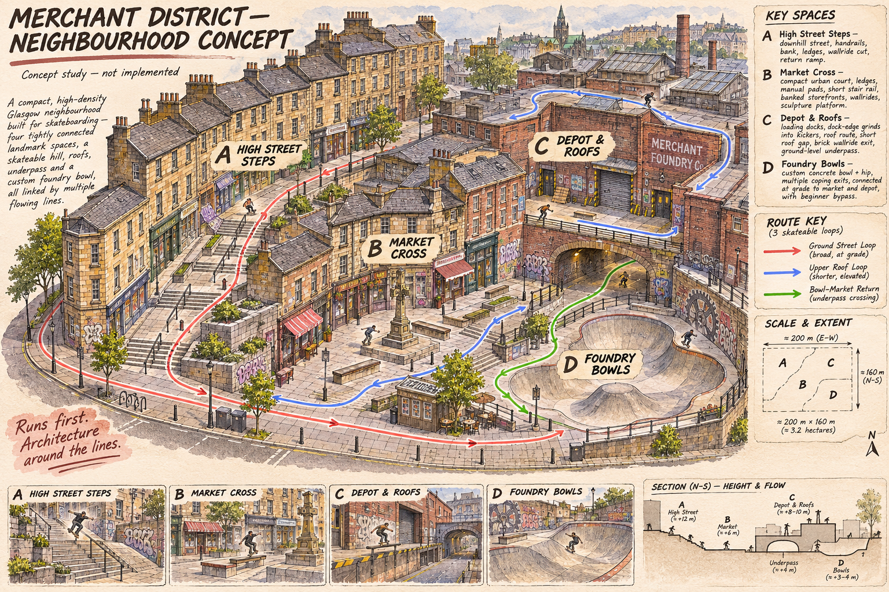
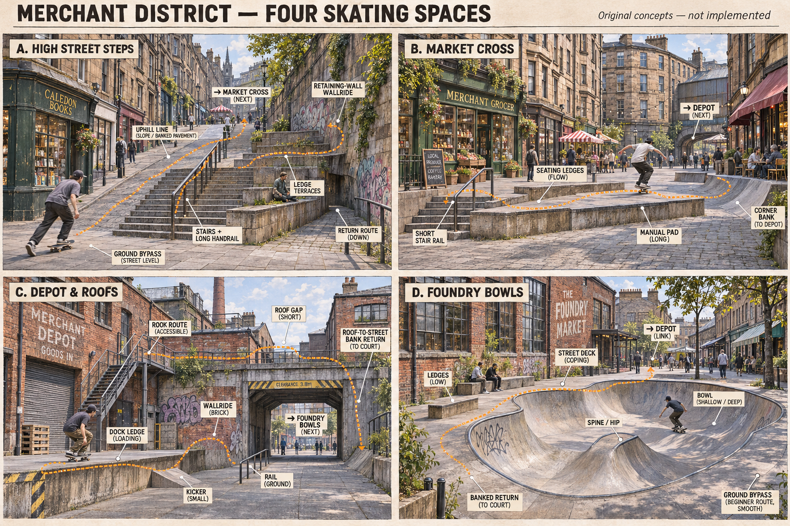

# Merchant District: overall and section concepts

The owner liked these sketches on7 November2026 and asked us to keep the game
recognisably Glasgow. This accepts a visual direction, not an implemented map,
physical line, finished art or AAA/M5 acceptance result.

These are original AI-assisted project illustrations generated with `image_gen`
in this session. Original outputs remain intact; the manifest pins these exact
copies. No franchise map, screenshot or production asset is included. The brief
below summarises the design intent; it is not an exact archived generator prompt.

## Desired skating spaces

| Section | Experience | Construction target, not an image measurement |
| --- | --- | --- |
| High Street Steps | The hill itself is a skate spot: parallel handrails, terraces, banked pavement, wall exits and several ways back. No long scenic journey to reach a distant park. | Playable terraces fromY4 toY12; slopes and landings must sustain actual motion. |
| Market Cross | An enclosed urban interchange with several visible next tricks: stair rail, stone seating, manual pad, sculpture plinth and corner-bank return. | Central court atY4; clean landings and a broad ground bypass. |
| Depot and Roofs | Loading ledges, kickers, wallrides and a short upper route cross a genuine lower passage and return to the street. | Loading deckY6, roofY10, underpass floorY4/undersideY8.5. The4.5m headroom needs native body/trick/camera checks. |
| Foundry Court | An original bowl/hip and street deck embedded beside the other spaces, with two useful exits and a beginner bypass. | RimY4/lower streetY2.5. No commitment to the existing40×30m skatepark or a distant uphill access path. |

The200×160m notation is an exploratory neighbourhood envelope. It is neither a
measured reference-game size nor a fixed requirement. Coloured arrows express
intended connections; native input replays must prove achievable launches,
landings, returns and uninterrupted combos. The roof access must be skateable:
a drawn staircase alone does not provide access in the current game. Correct any
illustration label or impractical detail when constructing the real level.

## Glasgow identity

Keep Glasgow as the setting. San Francisco, Los Angeles and London inform spatial
design, not a replacement architectural identity. Use the inspected
[Glasgow reference dossier](../../research/GLASGOW_REFERENCES.md),
[Barras/Barrowland references](../../research/BARRAS-CLYDE-REFERENCES.md) and
[Exchange/gallery references](../../research/EXCHANGE-GALLERY-REFERENCES.md).

Prioritise sandstone tenements with credible bay proportions, cornices and sash
windows; tiled close entrances; brick industrial/railway arches; market/shop bays;
Scottish street-name plates, ironwork and locally recognisable landmark forms.
Make landmarks part of the skating composition. Do not add remote sightseeing
areas, a long empty quay or a mandatory park climb to prove local identity.

Business names in generated sketches are illustrative fictional signs. Author
readable production signage deliberately, and verify real current occupants
before claiming a faithful shopfront. Reference photographs remain references,
not automatically licensed textures. Reuse the game's existing licensed material
library and create original geometry/details.

## Implementation ownership

The level designer owns the chosen native terrain, openings, support/guide/route
records and clearances. The environment architect owns street-facing architecture
around that geometry. Root owns lazy level selection and integration; the career
book keeps City Tour progress separate and settings/unlocks global. Independent
topology/BA and QE must review the actual result, including missed approaches and
the absence of long empty travel.

The [active plan](../../planning/COMPACT-LEVEL-REPLAN-2026-11-07.md) and
[ADR-035](../../architecture/decisions/ADR-035-san-francisco-scale-neighbourhood.md)
record the current contracts and implementation work. The original city remains
available separately as City Tour; it is not instantiated behind the new default.
