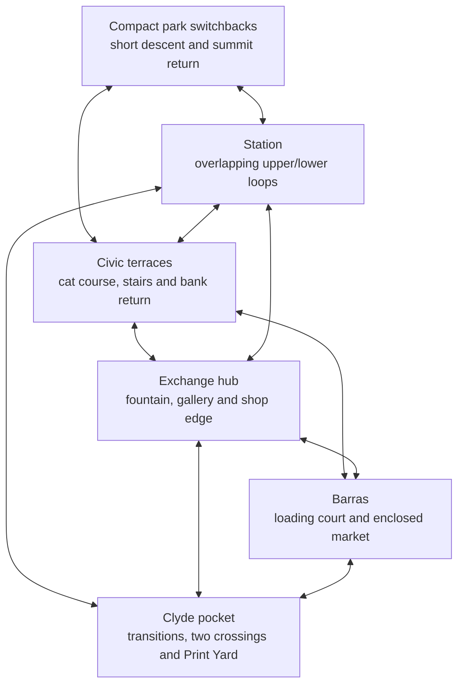

# Strict review of skating density and level value

18 October 2026. Senior arcade-skate level-design review, using the lessons of School/School II, San Francisco, London and Los Angeles. This is a design role, not a claim to have worked on those games. Reviewed production source at `321501d26b7c16d92541853e28c002faa0269f3a`, the current source-bound six-area capture and the live layout inventory supplied by the integration owner. **The present map fails the density and composition brief.** Its useful features are distributed across too much traversable ground, and too many paths provide transport without a useful skating choice or a convincing scene.

This judgement supersedes earlier implications that the accepted local place slices establish a well-composed whole level. Those slices repaired real problems and remain useful building blocks. Passing collision tests, completing 48 route polylines and exposing 196 grind tracks do not establish the next trick, a satisfying return, clear discovery or replay value. Higher-resolution shopfronts, a narrower camera or a new collection of props would leave the underlying spacing problem intact.

## Evidence and limits

- Read current `glasgow_square.gd`, `outdoor_routes.gd`, `transition_park.gd`, `skate_edges.gd`, city/landmark dressing, goal/gap/encounter interfaces, [current hardening packet](../planning/ARCADE-HARDENING.md), [previous lead review](LEAD-DESIGN-REVIEW.md), [playability repair](PLAYABILITY-REPAIR-BRIEF.md), Exchange and Barras/Clyde briefs. Some historical briefs still describe vert as unimplemented; the current three real transition faces and their tested returns supersede that statement.
- Opened **all 41 actual PNGs individually** in [area-current](../testing/arcade-response/area-current/README.md): four Exchange, four civic, four station, four Barras, five Clyde, three park and 17 half-pipe images. In particular, the apparently empty paving is visible from the actual production chase view, not only an overhead map.
- The capture contains six independently placed ordinary-input district segments and a separate pipe fixture. It is not a continuous trip between districts. No new engine session, human control session or commercial THPS game was run by this reviewer. Its traced distances/times below are recorded facts; a claim that the interval feels empty or badly paced is design judgement. A safe no-trick driver does not prove that tricks are impossible along its path.
- The integration owner exported the live 196 rails, 48 routes, three transition faces and a 4 m topmost standing grid. [Spatial evidence](../testing/level-density/README.md), [metrics](../testing/level-density/metrics.json) and [layout](../testing/level-density/current-layout.png) provide the integration owner's source-bound calculations. A proximity circle is not a reachable takeoff, a correctly oriented rail approach, a clear landing or a linked combo. Stacked lower station space is omitted from that topmost grid.
- Classic references are the previously inspected player guides in [CLASSIC-LEVEL-DESIGN](../research/CLASSIC-LEVEL-DESIGN.md). The useful comparison is related local spaces, multiple exits, overlapping heights, named features and repeatable chains. No exact THPS dimensions, developer intentions or copied layouts are inferred from those guides.
- Production murals, detailed fitted facade and rejected backdrop experiments are **OFF**. They cannot be counted as current visual interest. See [normal world construction](../../game/levels/glasgow_square.gd#L78) and [facade default](../../game/levels/art/facade_bay.gd#L10). The actual current skyline defects remain visible.

The integration owner's live proximity calculation is consistent with the visual problem: 64.8% of 6,976 clear topmost standing samples are more than 15 m in 3D Euclidean distance from a grind polyline or transition; the median is 25.18 m. In the broad south-landscape sample band, 98.3% of 2,871 samples exceed 15 m and the median is 75.8 m. **These are distances, not percentages of dead or uninteresting ground.** Banks, named gaps, useful manual/landing space, line of sight, vertical path connectivity and lower station space are not represented in that proxy. The region labels are broad. The 196 tracks also include 146 ledges, many coming from different sides of the same prop; count alone overstates independent feature variety. The critique below combines these limited measurements with actual images and feature relationships.

## What earns space

A skating feature should offer at least two useful relationships: another approach, a different exit, a return, a transfer to a neighbouring feature, an understandable risk/reward choice, or a challenge that teaches a reusable line. A long isolated grind is one feature, even when represented by several track IDs. Four grindable sides of one planter are not four independent skating destinations.

An architectural or scenery feature earns space by framing a route, closing the horizon, giving a reliable landmark, separating two rhythms, or making a boundary understandable. It does not have to be grindable. It also does not need an accessible back lawn, a walkable roof or a 30 m empty forecourt merely because the art exists.

Empty ground is justified by a real landing, charge/run-up, recovery, camera turn or reveal. Such space needs an identifiable purpose and an appropriate length. A 20 m approach to an optional large gap can be valuable; a 20 m strip before every ordinary low rail is not. An easier bypass should be short and legible, not the largest route in the arena.

**Strict rule for the next slice:** remove or compress low-value travel before authoring another prop. Reuse the strong feature groups at their native proportions. Do not blanket-scale ramps, stair sets, market stalls, architecture or the rider to make the map smaller.

## Ranked defects

| Rank | Defect and evidence | Required design response |
|---|---|---|
| 1 — cut | The south landscape is a **560 × 90 m = 50,400 m²** terrain rectangle behind the 300 m south quay. The useful Print Yard occupies a small local pocket near X35…78/Z122…137; most of the landscape has no authored skating destination, goal or return reason. Source: [Clyde landscape and yard](../../game/levels/outdoor_routes.gd#L154), [far boundaries](../../game/levels/outdoor_routes.gd#L63). This is source inventory, not a complete human tour of that grass. | Remove the distant grass from the playable remit. Retain a bounded south landing/Print Yard/bridge return. Make the remaining bank and Carlton Place mass scenery behind a coherent visible boundary. Do not simply delete support while leaving an open mouth into a fall. |
| 2 — compress | Park access consumes **84.36 m** from the station-side approach or **103.04 m** along the almost straight civic promenade before the main loop. The loop is **252.42 m**, with a **128.42 m** cutback. The recorded first 65.21 m takes **11.82 s** and shows primarily asphalt, grass, trees and bends. [Current park images](../testing/arcade-response/area-current/kelvingrove-01.png), [routes and land](../../game/levels/outdoor_routes.gd#L206). | Bring the skating hillside to the city. Retain useful elevation and a fork, shorten both approaches, fold the cutback into a compact return and make the terrace/hip/curb relationships useful locally. Scenic trees and another long asphalt ribbon do not pay back the commute. |
| 3 — compress/reconnect | Both quays are 300 m wide; the two crossing X positions are **−98 and +35**, **133 m apart**. The published north-quay route is **232.20 m** including approaches. Current Clyde 01/02/03/04/end show a repeated flat promenade and distant isolated ramps. The measured 95.63 m weave takes **17.15 s**. [Source](../../game/levels/outdoor_routes.gd#L131). | Concentrate the crossings, pipe, quarter, coping and south yard into one recognizable river playground. Keep river width and bridge identity; reduce longitudinal playable spread and useless far quay. The river should provide a risk/choice, not a long trip to find the next object. |
| 4 — recompose | Four broad core courts use similar rectangular support and repeated paving. Exchange lower court is 70×60 m plus 70×24 m gallery terrace; civic 70×72 m; station and Barras each 80×87 m before local overlays. In Exchange 01/02/end and George 01/02/end the next useful feature sits at the edge of a large open apron. [Core floor](../../game/levels/glasgow_square.gd#L247), [civic](../../game/levels/glasgow_square.gd#L545), [station](../../game/levels/glasgow_square.gd#L596), [market](../../game/levels/glasgow_square.gd#L619). | Consolidate existing banks, edges and landings into recognizable feature groups. Pull boundaries and building masses toward their useful approaches, preserve a few purposeful release pockets, and replace rectangular bypass laps with shorter intersecting choices. |
| 5 — cut/rework | Repeated facades and decorative fence openings create distant places that look equally important. George 02, Barras 02, park end and Clyde end expose empty horizon. [Images and independent findings](../testing/arcade-response/area-current-visual-review.md). | Close or frame these views using moved existing masses and solid scenery first. A single grounded landmark is better than more repeated shop bays. Keep necessary long skyline silhouettes; do not turn on a failed backdrop candidate as a shortcut. |
| 6 — rework | Several optional lines are individually feasible but weakly related. The standalone Exchange teaching rail, short gallery ledge, market rail, park summit coping and low Print Yard hip do not by themselves form a repeatable circuit. A route name containing “loop” may describe a transit return, not an earned combo loop. | Prove the exit-to-next-feature relationship, including an ordinary-input return and a realistic miss. Keep the feature only if it contributes to that relationship or teaches a clearly useful skill. |

## Travel accounting

Lengths below use the live production polylines, including their actual sampled curves. Times headed “model” are **distance ÷ constant speed**, not measured play and not a finding that every metre is empty. The 5.8 m/s comparison is approximately 21 km/h, close to the current capture's ordinary travel speed; 10 m/s is a faster comparison. There are legitimate tricks beside portions of these routes.

| Current interval | Length | Model at 5.8 / 10 m/s | Value judgement |
|---|---:|---:|---|
| `kelvingrove_george_promenade` | 103.04 m| 17.77 / 10.30 s|A long near-straight connector whose major payoff is being somewhere else. Reject this length in the compact version.|
| `kelvingrove_central_climb` | 84.36 m| 14.54 / 8.44 s|The grade contributes movement, but it duplicates the cost of getting to the park. Keep a short climb with a visible fork, remove the long approach.|
| `kelvingrove_rolling_loop` | 252.42 m| 43.52 / 25.24 s|Bends and elevation are valuable. Their present spacing is excessive for the small number of distinct authored skating situations.|
| `kelvingrove_cutback_return` | 128.42 m| 22.14 / 12.84 s|A second descent is structurally right. Its long return still spends too much travel for one small hip/ledge cluster.|
| `clyde_north_quay` | 232.20 m| 40.03 / 23.22 s|An interdistrict river link and optional edge skating are valuable; a nearly continuous broad strip of this length is not justified.|
| Safe versus broken crossing X positions | 133.00 m apart| 22.93 / 13.30 s|Safe/advanced alternatives should be recognizable alternatives within one local river decision, not far-apart destinations.|
| `barras_south_link` | 72.00 m| 12.41 / 7.20 s|Contains the approach/market item corridor. Its excess floor east of the actual entrance reads as a loading apron, not a market. Compress while retaining the item/approach lesson.|
| `barras_back_lane` | 116.10 m| 20.02 / 11.61 s|A second way out is good. Two long orthogonal legs with no distinctive corner activity are too costly. Reconnect through a shorter enclosed loading close.|
| `exchange_fountain_loop` | 148.00 m| 25.52 / 14.80 s|This is the broad rectangular **route around the court**, not the fountain coping. Do not call 148 m of transport a long fountain trick. The actual coping is 38.94 m.|
| `gallery_civic_ascent` | 146.45 m| 25.25 / 14.65 s|Contains several useful height changes and landmarks; keep those. Compress the repeated flat approach/release portions between them.|

Recorded current fixtures: Exchange 73.27 m / 13.47 s, civic 77.61 m / 14.52 s, station 81.91 m / 15.25 s, Barras 72.30 m / 13.78 s, Clyde 95.63 m / 17.15 s, park 65.21 m / 11.82 s. Their actual controls prove bounded traversal and show the spacing from chase height. They deliberately do not attempt tricks and cannot measure human line discovery or classify the whole duration as dead time.

## District decisions

### Royal Exchange — keep the fountain/gallery pair; compress the plaza around it

**Keep:** `Grind_Coping_ExchangeFountain`, actual cylinder/38.94 m loop at `(0,0,10)`, the gallery stairs/approach at Z−18…−4, the attached Y2.65 gallery entrance, bent `Grind_Ledge_GalleryEntrance`, west shopfront bank/`Grind_Ledge_ExchangeShops`, and the cone statue. They offer complementary curved, low, stair and architectural skating. The gallery and fountain together are the strongest first-minute landmark pair. [Attachments](../../game/levels/glasgow_square.gd#L262), [rails](../../game/levels/glasgow_square.gd#L333), [fountain](../../game/levels/glasgow_square.gd#L959).

**Compress:** the southern spawn-side apron and the wide east/gallery approach. `royal_exchange-01` and 02 show long open pacing to the shop corner; 03/end show broad uphill paving with the interesting entrance left well ahead. Do not remove beginner turning space; give it one clear size and a visible next choice. The court's open floor currently dominates its features.

**Rework:** `Grind_Rail_Exchange` at `(12,0,9)` and the two long planter seats at X−15/+17,Z13. They can form a fountain-to-edge chain; at present the plain teaching rail reads as a placed rail rather than a consequence of the square. Retain it only by integrating its entry/release into the fountain/seating arrangement. Do not add more short rails in the unused corners.

**Cut:** duplicated frontage lengths whose only effect is extending a blank bypass. Preserve Mo's `busker_big_finish` identity near `(28,0,31)` and move the performer, logical anchor, visible stage/support and interaction area together if the court edge moves. A new mural above this apron would improve a wall but would not improve the trip to it.

### George Square — keep the civic stair and bin-cat course; stop leaving them on opposite ends of a lawn-sized pavement

**Keep:** Y4→6 civic bank/stair split, `Grind_Rail_George`, chamfered civic garden ledge, the real A/B/C coping course at Z−91, grounded bin-drum/cat stage at `(0,4.65,−98)`. The side act has an actual ordered physical skating objective and payoff; it earns its place. The civic facade supplies a strong north bearing. [Civic geometry](../../game/levels/glasgow_square.gd#L545), [A/B/C](../../game/levels/glasgow_square.gd#L580).

**Compress:** broad south/cross-court apron near Z−74 and the 20 m-deep upper forecourt at Z−128…−108. The upper court needs a landing and a turn toward a descending bank/rail, not an interchangeable promenade. George 01/02 show the present interval and horizon break; 03/end show an isolated large bank runout. Keep the cat course's real run-up, inter-plinth gaps, landing and 32 m logical area until it is migrated coherently.

**Rework:** make the chamfered garden edge a choice that feeds the cat runout or civic bank, instead of a pleasant-shaped obstacle off the main route. Place the stage where a completed line naturally returns the camera toward it. A stage surrounded by an enormous bypass makes the correct Glasgow joke difficult to notice.

**Cut:** extra open forecourt perimeter and unused repeated side-frontage bays. Preserve the A letter's relationship to the upper route and the S letter's back-close discovery; they can move with those routes. Do not preserve an empty commute just to preserve an old collectible coordinate.

### Central Station — the strongest topology; remove the empty concourse surrounding it

**Keep:** high/low overlap. The service walk at X−122…−105/Z−20…4 has its real underside at Y4.6 over the Y2 lower floor, with 2.6 m raw vertical clearance. The platform gap, access banks, stairs, `Grind_Ledge_ServiceWalk` and ground rail give different risk levels inside one footprint. The canopy is worth keeping because it supplies a distinctive covered atmosphere and frames those overlapping routes. [Station](../../game/levels/glasgow_square.gd#L596), [drop-edge registration](../../game/levels/skate_edges.gd#L181).

**Compress:** unused east concourse and broad north/south runouts, not the undercroft clearance. In station 01/02 the large empty lower paving and full-width beam dominate the view. Station 03/end reveals another large apron beyond the raised bank. One covered court should be more interesting per metre than an outdoor square, not merely a square with a roof.

**Rework:** move `Grind_Rail_CentralGround` from its isolated X−64/Z−5 position into a deliberate undercroft exit/return relationship, keeping safe walking width and camera clearance. Adjust the canopy to the shortened court rather than retaining the complete seven-arch length automatically. Keep a higher view through the canopy to the next destination.

**Cut:** the long blank concourse bypass and repeated canopy/column segments beyond the useful upper/lower loop. Do not replace the2.6 m clearance with a visually tighter ceiling or fill the underside to save collision work. This district earns compact vertical complexity.

### Barras — the useful market is a small island inside a much larger empty market-shaped court

**Keep:** the actual opposed stall rows at X108/120,Z2/13, sheltered X114 aisle, X103 western alternative, loading steps/rail and bank, repair-hall chamfered skirt with `Grind_Ledge_MarketHall`, genuine Barrowland sign/venue bearing, Mairi's delivery and the hidden recording alcove. These establish architecture, a fork, a safe route, a physical task and discovery. [Market court](../../game/levels/glasgow_square.gd#L619), [hall](../../game/levels/glasgow_square.gd#L635), [stalls](../../game/levels/glasgow_square.gd#L652).

**Compress:** the gap between the western repair-hall island and the eastern through-market, the large southern collection apron and east outer lap at X126. Bring the market to its entrances instead of making the player cross a whole square to find four stalls. The 80×87 m support is far too large for the interesting footprint. Barras 01 shows the long approach beside a blank backing; 02 shows a promising enclosed moment; 03/end immediately releases back into too much paving.

**Rework:** `Grind_Rail_Barras` at `(114,0,27)` should be a continuation of a counter/loading line and feed a short return into the market. It is currently a rail beyond the small interesting aisle. Use the repair-hall ledge to create a second interior loop and give one lane a loading-bank connection. Stalls are currently chiefly opposed rows; one offset intersection/reveal is worth more than a second identical row.

**Cut:** the broad outer perimeter as a required circulation idea. Retain one quick novice bypass and one technical covered route. Preserve the secret's glimpse and second exit; do not wall it away. Ground rings and collectibles in these images explain tasks but are not substitutes for a readable market layout.

### Clyde — keep river breadth and risk; cut promenade length

**Keep:** recognizable continuous suspension crossing, separate eight-metre optional transfer, lower water hazard/recovery, one working half-pipe, one quarter, accessible quay coping and the south Print Yard hip/ledge. These offer a different rhythm from the courts. The river's 38 m physical water width is useful for its identity; the problem is the huge length along it. [Quays/bridges](../../game/levels/outdoor_routes.gd#L131), [transitions](../../game/levels/transition_park.gd#L38).

**Compress:** safe/advanced crossing separation, the space between crossing and yard, and the gap between transition features. The current safe bridge is at X−98; the optional transfer at X35; the pipe's flat bottom is centred X−22/Z60.5 and the quarter toe X17/Z64.5. The pipe and quarter are useful but read as independent objects on a promenade. Bring them into the bridge/yard choice so that leaving vert has a useful street continuation and vice versa. Do not impair the now-tested native pipe radius 3.2 m, width 10 m, toe joins, return bounds or deck depth 2 m.

**Rework:** the long quay-edge grinds. They are valid movement options; long featureless straight grinding offers little route planning after entry. Preserve useful stretches that lead to a bridge mouth/transition/landing and split the visual composition with actual architecture, not arbitrary awards every few metres. No virtual rail should cross a flush bridge opening. Reusing the South Portland-inspired portals and joined houses as framing is more valuable than another generic shop row.

**Cut:** distant ends of the playable quays and most south grass. Replace their open playable promise with believable built mass/retained banks. Keep all water-facing optional risks readable and the existing bounded recovery. Current pipe 05/07/10/12/15 make the excessive longitudinal emptiness particularly clear from above. Their real successful wall returns demonstrate a working feature, not a working river arena.

### Kelvingrove — retain one interesting piece of hillside, not a whole road excursion

**Keep:** actual ground relief, the fork/cutback concept, granite curb skating, the small hip/ledge, a summit/viewpoint identity and downhill return. Green relief is a useful contrast to the sandstone city. [Main path and connections](../../game/levels/outdoor_routes.gd#L206), [hip/viewpoint](../../game/levels/outdoor_routes.gd#L255), [edge authoring](../../game/levels/skate_edges.gd#L197).

**Compress:** both access roads and the hillside lap. Preserve the 6→17 m useful height change by folding it into shorter switchbacks with properly designed landing shelves. Do not simply squash 252 m of curve into the same control-point count or steepen it into an unrideable shortcut. The current first 65 m offers pleasant turning but no compelling local choice before the fork, and its pale horizon does not sell Glasgow parkland.

**Rework:** bring the summit coping and cutback hip within a short shared loop. At present the coping at X−177…−164/Z−184 sits at the end of a summit spur; that is a one-use viewpoint visit unless it feeds a descent. Give it a visible low-risk way back, a diagonal launch toward the lower shelf and an exit to either city port. Use retained landscape to frame the path and expose the city silhouette, rather than planting more individually readable trees into every empty metre.

**Cut:** the long civic promenade, surplus far grass and any duplicated path segment with the same view, grade and next action. Keep a small calm viewpoint as a deliberate reward; it should be an optional few seconds beside the skate loop, not the reason to build a second commute. Trees are scenery and can be batched, but tree quantity cannot close the skating-density defect.

## Proposed smaller map

Keep all six existing district identities, but compose **a paired civic/Exchange hub, two close side arenas and two attached outdoor pockets**. Six names do not require six equally large standalone maps. The adjacency below is a design proposal, not newly implemented geometry:

Retain at least two supported exits for every arena. Short doors/closes should reveal a differently shaped space and return to the hub. A high route may cross a low route; a long outer lap is not required to make a map nonlinear. The diagram preserves existing relationships; none is permission to add another district.

### Sketch targets, before a collision-safe remap

These are **design ceilings to test**, not accepted coordinates or a scale factor. Exact approach volumes, landings and the capsule/camera may require a larger local allowance. Reducing a rectangle does not alone establish better level design.

| Piece | Target for the next design sketch | What must survive |
|---|---|---|
| Exchange active court/gallery sequence |About 50×55 m, with a larger space only where its useful stair run-up/landing requires it. Pull the next feature into view at each exit.|Native fountain radius, entrance column/ledge relationship, separate stairs/bank bypass, Mo/cone access.|
| Civic active terraces |About 50×48 m; shorten the upper empty forecourt and south approach around the actual course.|Cat A/B/C distinct captures, supported charge/landing lengths, stair/bank split, stage and civic bearing.|
| Station |About 60×65 m, using overlapping heights rather than a wide unused concourse.|Mind The Gap, upper route, true undercroft, native overhead/camera clearance, accessible novice bypass.|
| Barras |About 60×65 m with a legible offset interior and a short exterior return.|Covered/west delivery alternatives, loading gap, market collection/recording discovery and sign reveal.|
| River playable length |160–180 m rather than 300; crossing separation 35–55 m rather than 133. Restrict south play to landing/yard/return footprints.|38 m river breadth, native eight-metre optional bridge opening, safe crossing, water recovery, intact pipe/quarter dimensions.|
| Park |100–140 m local loop, two 20–35 m approaches, short return sharing useful ground with the climb.|A real fork, height, curb/hip/terrace loop, both city exits and a small optional viewpoint.|

Do not attempt these targets by placing one transform over the entire current district. Native feature groups can move intact; join surfaces, support-query footprints, boundary contours and routes must be reauthored. A first slice may leave the overall silhouette unchanged while moving one blank-facing frontage toward the actual useful court. The acceptance test is that its skating paths improve, not that an overview becomes smaller.

### Required local combo loops

Each row is a proposed relationship to prove with real production controls after reauthoring. It is **not a claim that the present geometry already completes these combos**. “Return” may allow banking; the linked action sequence must actually remain one combo where claimed. Preserve a short supported ground alternative and a quick retry after a miss.

| Arena | Two or three loops that earn the space |
|---|---|
| Exchange |**Fountain/seating:** partial fountain grind → pop to adjacent seat/rail → manual through a short landing apron → bank/turn back toward a different fountain entry. **Gallery descent:** entrance bank → bent gallery ledge → stair/drop air → low court continuation → shop-edge bank return. **West street:** shop bank/ledge → planter edge → fountain-side release → short west return, also usable in reverse. Pull these groups together; do not require a 25 s perimeter lap between attempts.|
| Civic |**Civic rail:** stair-rail descent → chamfered garden edge → manual toward bank → bank turn back to upper approach. **Cat course:** retain real A→B→C captures/bank, with the runout feeding a short turn that shows the bin-drum/cat payoff and returns toA. **Terrace crossover:** bank to low workshop seat edge → diagonal lower landing → opposite civic bank/stair option. Keep this distinct from the ordered challenge so accidental edge captures cannot masquerade asA/B/C.|
| Station |**Upper/lower:** access bank → platform rail/gap → clear lower drop → undercroft edge/manual → return bank. **Service walk:** stair/bank access → service-walk ledge → controlled drop toward the repositioned ground rail → lower exit returning to the access. An optional reverse line should make a different use of the same architecture. Avoid a compulsory crawl beneath a low beam after every upper landing.|
| Barras |**Loading/market:** loading rail/drop → manual into one market lane → counter edge → short southern return to the loading bank. **Hall/interior:** repair-hall bank → angled hall ledge → low aisle continuation → offset stall corner → return around the hall. **Delivery lesson:** Mairi's actual manual/gap/bank → chosen covered/west gates → south counter, then a useful free-skate return rather than a large task-only apron.|
| Clyde pocket |**Vert/street:** pipe air/lip or coping → open-end exit → quay ledge/manual → quarter return, with a route back to the pipe. This does not assume an unimplemented automatic spine transfer. **River loop:** advanced crossing → Print Yard hip/ledge → south-bank link → safe crossing → north transition/edge. Its spacing must supply useful intermediate actions; do not merely shrink the 133 m separation and call the loop proven.|
| Park pocket |**Hill figure-eight:** upper curb → diagonal supported air/manual shelf → cutback hip/ledge → short lower switchback to the climb. **Viewpoint return:** terrace coping → visible downhill shelf → curb turn → either city exit, with a supported no-jump alternative. Height should enable action and route choice rather than only slow uphill transport.|

Tap/charged Ollies now have measured flat airtimes around 0.48/0.68 s. At 10 m/s this gives roughly 4.8/6.8 m of horizontal travel before equal-height landing, not permission to clear any gap of that width. A planned 12 m flat-air transfer would conflict with the current physics. Charge needs real run-up; a bank/drop can change the feasible trajectory and needs its own proof. Manuals can bridge longer intervals, but asking the player to balance across every empty plaza does not make those plazas interesting.

## Glasgow identity: what helps and what does not

| Keep as spatial identity | Insufficient on its own |
|---|---|
| Gallery portico organizing a bank/ledge entrance and stair descent; fountain seen from more than one exit.|Repeated generic stone shopfronts extending otherwise empty aprons.|
| Barrowland sign revealed through a genuinely enclosed market route, loading architecture and real counters to skate.|A large sign facing an 80 m paved rectangle with four stalls on its edge.|
| Station canopy over intersecting high/low paths, piers and an understandable gap.|Seven identical arches covering mostly spare concourse.|
| River width below the rider, recognizable suspension portal, connected south terrace and safe/advanced crossings visible as a choice.|A 900 m scenic water plane and distant houses used to justify 300 m playable promenades. Scenic breadth may remain; playable length must earn itself.|
| Original bin-drum/cat act placed where a skating loop naturally returns to see its payoff.|An isolated entertainer, a floating label or more task rings in a blank square.|
| A framed grassy hillside with a summit bearing, a useful fork and a descent into the city.|Repeated sparse trees over an accessible landscape with no nearby skating decision.|

Murals can help one close-wall reveal or destination bearing after layout settles. They should be original, researched Glasgow-inspired work with clear provenance. They do not justify retaining an empty street, and the currently rejected preview must remainOFF until it passes the existing rendering gate. Do not paint over a missing background opening and describe the topology as repaired.

## Performance and acceptance budgets

The compact pass should spend **less total scene cost**, although moving more features into one camera view can increase simultaneous visible cost. A smaller map is not automatically faster.

- First slice: **no new material/texture set, dynamic light, transparent facade, per-frame world script or new render pass**. Relocate/reuse or remove existing feature groups; net world render surfaces, physical shapes and startup rail candidates should be non-increasing. A removed feature's count is not sacred; the ten goals and three encounter identities are.
- Each new integrated architectural bank/ledge must replace old pieces and remove obsolete or overlapping visuals/collision. Do not leave hidden copies beneath a smaller arena. Keep render/collision/support authoring coherent and retain existing startup batching/index behavior.
- At matched production chase poses, including the worst junction where several arenas become visible, require reported draws and primitives no higher than baseline. Measure texture/mesh memory rather than assuming reused assets cost nothing. Do not lower the 220 m skyline range or break distant walls to manufacture a win.
- Use frozen before/candidate/before runs with identical quality, viewport, route inputs and no competing engine jobs. Retain p50/p95/p99, long frames and counters. Apply the existing conservative frame-spike admission gate; **reject a failing view**, including an outdoor junction that was previously cheap. Triangle reductions are not a timing pass. Software-rendered evidence does not certify Apple M5 performance.
- Design gate for each core arena: at least **two distinct real linked action sequences**, a short reconnectable return, two supported exits and a novice bypass. Every principal feature exit should show or frame another useful option; an unvaried interval of about 3 s requires a specific landing/run-up/recovery explanation. These are project design targets, not a measured law of THPS.
- Traverse the first minute and each changed arena with ordinary controls and actual production camera. Include entering from both ends, choosing the wrong branch, overshooting a grind, too-short/long charge and missing the optional line. Retain visible rider/board, understandable boundaries and quick supported recovery. Do not prove only the ideal centerline.
- Take actual approach/exit screenshots and a source-bound moving trace. A top-down density map and quiet fixtures remain supporting evidence, not approval of fun or human difficulty. A human unaided attempt, target Mac/controller feel and final art remain explicit gates.

## Migration order and risks

The integration owner maintains the implementation task packet. Continue under the existing 75 records, especially **M03-001…005, M03-011…014, M05-001, M06-007 and M07-001/007**; do not replace their complete records with this review or invent a new district milestone.

1. **Measure and mark cuts.** Keep the accepted current capture/inventory immutable. Mark every retained feature group, exact support, approach, landing, return and scenery-only region. Publish a proposed old→new anchor table before moving geometry. Classify each cut surface as closed scenery, supported landing or readable water hazard. The current 48 route IDs form a migration checklist, not 48 immutable polylines.
2. **Prototype a single compact Clyde pocket.** This attacks the worst surplus ground while keeping the existing core career arenas stable. Move intact bridge/yard/pipe groups, close excess south play with visible supported boundaries and prove two actual returnable combos. Preserve the native pipe mathematics, water recovery and safe crossing. If the local play does not improve, reject the candidate before propagating coordinates citywide.
3. **Shorten the park.** Bring its useful hillside/fork into short approaches from the two retained city ports. Regrade and prove climb, descent, curb/hip return and misses, rather than merely moving endpoints. Keep the previous map playable between checkpoints; do not move every district and leave a broken integration.
4. **Recompose core aprons and ports one arena at a time.** Exchange already has three complementary features for a tight fountain/gallery/shop proof. Station must preserve overlapping clearance; Barras must preserve both task branches; civic must preserve the cat run-up/course/payoff. Each gets two real loops and its own physical/render checkpoint before the next move.
5. **Close composition and retest.** Refit existing mass silhouettes and scenery only to the accepted smaller footprint, then rerun full career/encounter/route/support/camera/render checks and actual ordinary-input exploration. Only after acceptance should final higher-fidelity art spend its budget on these stabilized hero features.

| Migration risk | Required protection |
|---|---|
| Ten goal/save identities accidentally changed by a map rewrite.|Keep career IDs/schema/rewards and collected kinds intact. Move H/A/W/K/S, market items, cone, hidden recording and relevant gap/visit anchors with real geometry. Re-prove all ten in one normal career run; do not inject goal completion. Current marker coordinates are in [goal authoring](../../game/levels/glasgow_square.gd#L991).|
| Three side acts become inaccessible or falsely complete.|Keep `busker_big_finish`, `cat_got_the_beat`, `gull_proof_delivery`; move actor, stage, offer/area/bounds, physical markers and routes together. Cat still requires exact `Grind_Cat_A/B/C` followed by actual positive bank. Delivery still requires actual manual/gap/bank, the selected three-gate branch and real arrival. [Definitions](../../game/levels/glasgow_square.gd#L110).|
| Rail/feature snapshots point at old coordinates.|Rebuild authored/world track snapshots, selected semantic edges, startup index and transition feature transforms after moved geometry. Coordinate-stamped incidental `Grind_Edge_…` IDs can change; challenge IDs must remain stable. Do not keep phantom rails where a prop was removed.|
| Map/query/physics disagree after a rigid group move.|Core terrain dictionaries, polygons, layered queries, outdoor height functions, boundary sampling and map/checkpoints must use the same new authored coordinates. Existing `get_ground_height` is not automatically transformed for an arbitrarily moved child. Actual ray/shape/ordinary movement evidence remains required.|
| Closed scenery still looks like a playable exit, or the cut creates a dry fall.|Visible retaining face/building/terrain and matching bounded collision must close the actual old opening. Preserve alternative exits and full supported approach widths. No world-wide invisible catch slab, unmarked edge or mandatory water reset.|
| Compressing geometry removes charge, landing or camera clearance.|Keep native ramp radius/width, real approach/landing lengths, underside and turning pockets. Re-prove geometry with the current heavier tap/held physics. A smaller footprint is not worth a camera inside the torso or a rail landing in a wall.|
| Old scripted navigation becomes misleading evidence.|Reauthor driver waypoints and fixtures to the new real paths, retain assertions of real action/landing/capture identity and all expected goals/payoffs. Record failed attempts honestly; do not widen gates or lower awards solely to make changed coordinates pass.|
| Previously culled features now share one viewport.|Budget worst visible junctions, preserve native batching/culling and keep failed art defaultsOFF. Perform actual timing rather than treating net lower total polygons as proof of lower frame spikes.|

**Decision:** retain the fountain/gallery, civic/cat, station high/low, enclosed market, working transitions/bridges and a compact piece of park relief. Compress their travel, reconnect their exits, and remove most accessible scenery-only spread. Start with one compact Clyde proof; [LEVEL-DENSITY-NEXT](../planning/LEVEL-DENSITY-NEXT.md) owns the ordered implementation and resumable acceptance tasks. The next success is two convincing repeatable lines in a smaller existing arena, with an intentional landing and a visible way back. Another standalone prop, façade row or long road does not close this review.
