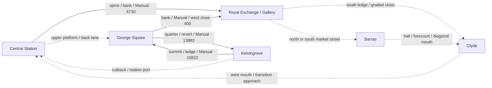

# All scored gaps, authored routes and skating connections — 7 November 2026

The current map has **8 scored gaps, 66 world routes, 67 HUD routes and 242 unique grind guides**. Every named gap and route now has a launch/arrival/next-choice audit in the [machine inventory](GAP-LINE-CONNECTIVITY-2026-11-07.json). The graph remains much weaker than the guide count suggests: four directed cross-area through-runs have source-bound one-bank evidence, but **no three complete cross-area circuits** are established by this audit. The east-quay return is **7,400 + 5,688 across two combos**, not one combo.

The strongest next steps are to join existing scored gaps to their next real bearings and to turn Station’s bank/halfpipe and Barras’ hall/market forecourt into coherent local return choices. These are original arrangements informed by the [Tony Hawk reference study](THPS-LINE-DESIGN.md), without copied layouts or assets. More isolated props or more route metadata would not resolve the owner’s flatland complaint.

[Open the interactive source plan](GAP-LINE-CONNECTIVITY-2026-11-07.html) to inspect every route, score trigger and grind ID, zoom the six areas, and compare candidate endpoints. It is a standalone geometry diagram; it contains no rendered or gameplay footage.

## Source and native scope

- The immutable source identity draft was independently checked **46/0** for all 8/67 constructor IDs and the fixed 56 + 8 + 2 world registry. Its old provider hashes remain unchanged; the round-contact installation has a separate currentness addendum. [Independent coverage](../testing/line-design-2026-11-06/gap-line-inventory-independent-01/README.md).
- A read-only export ran on the already-created ordinary default Main, before module inputs, at physics frame 1108 in the 09:39 native epoch. It captured **242 records and 242 unique IDs**, plus 33 public feature records. All 63 source-resolved route arrays agree with the actual snapshot within **0.000005779 m**; the three smoothed park routes and ground-projected gate now have actual exported arrays. [Exact snapshot, helper and process receipt](../testing/line-design-2026-11-06/gap-line-connectivity-2026-11-07/live-registry-01/preservation.json).
- That parent native gate is **rejected 133/1** for the real Clyde bank/coast/bowl-side full-body chase failure. The earlier ordinary required run is **rejected 6,526/7**, with three freed-object script-error lines. Successful route records below are bounded subsets, not a global/current gameplay pass. [Preserved earlier raw log and source index](../testing/line-design-2026-11-06/gap-line-connectivity-2026-11-07/named-line-evidence-index-01/index.json).
- Navigation points, nearby guides and generic edge metadata do not prove an earned catch, landing, return or combo. No runtime geometry/physics was changed and no extra Main or engine job was launched for this audit.

## What the game actually awards

`Main` feeds **skater actor origin and airborne state** to `GapTracker`; the header’s “board contacts” wording is not the runtime authority. The detector uses ordered scoring spheres, a 4-second gap window, a 20 m maximum sample step, and required airborne state at finish. A named award does not establish a clean supported landing or the next trick. This gap window is distinct from the existing 350 ms score-link deadline. All launch speeds below are unmeasured for the complete proposed handoff except the individually cited broken-bridge fixture; no universal speed was guessed.

| Scored ID | Approach / actual opening | Landing / next meaningful choice | Evidence and missing link |
| --- | --- | --- | --- |
| `exchange_launch` (300 points) | Y2 terrace→18m-wide steps; southbound; outside-cheek side banks remain alternatives. Trigger centres 8.158 m apart; scoring radius 2.2 m. | Lower court after the8m stair run; fountain starts aroundZ3.8, so forward landing/turn space is finite. **Next:** Manual around fountain tangent then earned coping catch; source route gallery_step_drop. | Generic detector units exist; C04 stair rail atX9.1 does NOT prove centreline gap volumes. Named-gap native input/award/landing remains unmeasured. |
| `central_gap` (600 points) | Y5 south platform via18m rise/run approach; northbound; physical empty intervalZ−1…−5. Trigger centres 6.000 m apart; scoring radius 2.0 m. | North platformX−101…−87/Z−20…−5 gives14m width/15m length, then a graded north exit. **Next:** North-platform perimeter/real edge pop or upper/lower service-walk return; not the separate south-concourse spine line. | Career native test requires the real named event and upper landing, but its navigation assigns grounded yaw. New strict mapped-steering same-combo return unmeasured. |
| `market_hop` (350 points) | Y1.5 loading terrace atX93; southbound through actual stair drop. Trigger centres 8.075 m apart; scoring radius 2.0 m. | Lower apron nearZ−6; old hall/C04 path passes west viaZ−2. **Next:** Free-skate Manual→hall ledge; or Mairi mission explicitly banks Manual/Ollie/gap before ordered delivery gates. | Both Mairi branches assert real gap_seen, Manual+Ollie and exactly1650 bank; driver uses grounded yaw. C04 hall approach usesX100.8, outside this gap centre, so is related evidence only. |
| `clyde_bridge_transfer` (900 points) | 5m-wide broken bridge north deck; actual unsupported openingZ94…102 is8m, trigger centres12m apart. Trigger centres 12.005 m apart; scoring radius 2.4 m. | South bridge deckZ102…124 then supported quay/yard. **Next:** Landing Manual→print-yard ledge/hip; safe bridge return. Current river fixture banks gap BEFORE yard traversal. | Compact river circuit uses>=15charge ticks and>=12m/s launch nearZ93; real named gap counted once, south landing/return proven in historical compact geometry. No one-combo yard continuation. |
| `clyde_handrail_to_cable_west` (500 points) | Handrail crown→same-side existing cable0.5m farther out; north-to-south scored direction. Trigger centres 3.076 m apart; scoring radius 0.7 m. | Cable finite crown facets12…19; actual physical capture must match same native owner/shape. **Next:** Earned cable grind→return pop→same handrail; safe deck landing. | Earlier required02 did not assert cable gap IDs. New copied-current WEST native observer proves actual southward gap:clyde_handrail_to_cable_west500 and three captures in one8696 bank; northward separate trial banks4109 with no gap award. Exact super-delegating tracker shadow parity, source/currentness and score calls retained; moving/full-body/inter-area circuit not admitted. |
| `clyde_cable_to_handrail_west` (500 points) | Same-side cable→handrail0.5m inward; north-to-south scored direction. Trigger centres 3.076 m apart; scoring radius 0.7 m. | Finite solid handrail then8m bridge deck; outward pop must land dry. **Next:** Bridge exit to north/south quay tricks; opposite direction is physical travel, not an implied reverse gap award. | Original zero-wait WEST return misses both0.7m trigger spheres (start1.255377m/end0.847871m). Retimed WAIT12 legitimately enters both in order and has prior air, but native destination rail capture precedes the gap update; current air=false rejects finish. EAST WAIT12 independently mirrors that policy boundary. No return award or policy repair admitted. |
| `clyde_handrail_to_cable_east` (500 points) | Handrail crown→same-side existing cable0.5m farther out; north-to-south scored direction. Trigger centres 3.076 m apart; scoring radius 0.7 m. | Cable finite crown facets12…19; actual physical capture must match same native owner/shape. **Next:** Earned cable grind→return pop→same handrail; safe deck landing. | Earlier required02 did not assert cable gap IDs. New copied-current EAST native observer proves actual southward gap:clyde_handrail_to_cable_east500 and three captures in one8696 bank; northward separate trial banks4109 with no gap award. Exact super-delegating tracker shadow parity, source/currentness and score calls retained; moving/full-body/inter-area circuit not admitted. |
| `clyde_cable_to_handrail_east` (500 points) | Same-side cable→handrail0.5m inward; north-to-south scored direction. Trigger centres 3.076 m apart; scoring radius 0.7 m. | Finite solid handrail then8m bridge deck; outward pop must land dry. **Next:** Bridge exit to north/south quay tricks; opposite direction is physical travel, not an implied reverse gap award. | Original zero-wait WEST return misses both0.7m trigger spheres (start1.255377m/end0.847871m). Retimed WAIT12 legitimately enters both in order and has prior air, but native destination rail capture precedes the gap update; current air=false rejects finish. EAST WAIT12 independently mirrors that policy boundary. No return award or policy repair admitted. |

All four cable gap definitions award north→south travel. The newer [copied-current native cable packet](../testing/line-design-2026-11-06/gap-combo-native-2026-11-07/README.md) now proves **WEST and EAST** three-bearing lines separately: southward each banks **8,696 once**, including the actual same-side entry gap500; northward each banks4,109 once with no score-gap awards. Earlier required02 did not inspect individual gap IDs; that historical limitation is preserved, not applied to the new packet.

The missing cable→handrail return has **two distinct measured causes**. Original zero-wait WEST input never enters either0.7m sphere (closest start1.255377m/end0.847871m), so that is a geometric miss. A real WAIT12 continuation enters both in order, has airborne travel, then captures the expected native handrail before Main’s next gap update: WEST capture414→gap415 and EAST642→643. Current-air=false then rejects the finish despite the prior flight. A narrow native-destination opt-in policy is a private proposal; ordinary airborne gaps and all bounds/deadlines remain unchanged. There is no demonstrated return award, new production detector behavior, rendered whole-body clearance or inter-area circuit in these packets.

## Directed area graph: actual combo evidence versus access

Solid arrows are the earlier source-bound mapped-input, single-bank through-runs. Dashed arrows are the principal source/native-access candidates requiring joined input and score proof. Neither style certifies a closed circuit or current visual fidelity.

| Required circuit investigation | Existing same-combo portion | Missing joined proof |
| --- | --- | --- |
| `CIRCUIT-WEST`: Central Station → Royal Exchange / Gallery → Clyde → Central Station | central_station→royal_exchange | royal_exchange→clyde, clyde→central_station. unmeasured closed circuit; no reset/bank/heading injection continuation allowed. |
| `CIRCUIT-EAST`: Royal Exchange / Gallery → Barras → Clyde → Royal Exchange / Gallery | None established by this audit | royal_exchange→barras, barras→clyde, clyde→royal_exchange. source-reachable transport ring; southern Barras junction strongest spatial revision candidate. |
| `CIRCUIT-NORTH`: George Square → Kelvingrove → Central Station → George Square | george_square→kelvingrove | kelvingrove→central_station, central_station→george_square. practice/fork/hip/upper-lower station actions should form distinct return; long grades unmeasured. |

Park→Civic→Gallery→Fountain is the strongest existing-geometry **three-area through-run** proposal. The component lines bank separately in their current tests. Joining them without a bank/reset is useful work, but even a successful through-run would still need a genuinely different return to become a closed circuit. The machine graph lists all 20 directed access/through-run edges separately.

## Six arenas: two distinct returnable lines remain the benchmark

| Arena / candidate | Existing actual opportunity and evidence | Remaining closure |
| --- | --- | --- |
| Royal Exchange / Gallery A: entrance → stairs → fountain | Forward mapped three-bearing chain14616; actual centre scored gap not included; return to original entrance not proved. | Full current same-rider returned line **open**; protected easy bypass retained. |
| Royal Exchange / Gallery B: west shop bank / ledge → rotated south bank → short court return | Different support/action family exists; complete mapped return and meaningful opportunity intervals unmeasured. | Full current same-rider returned line **open**; protected easy bypass retained. |
| George Square A: Cat A → B → C → east release / return | Challenge is implemented and legacy native-tested; grounded aiming is not current stricter mapped returned-line proof. | Full current same-rider returned line **open**; protected easy bypass retained. |
| George Square B: civic bank → lower court / island → Gallery → uphill return | 400 single-bank through-run exists; distinct closed return and join to entrance not proved. | Full current same-rider returned line **open**; protected easy bypass retained. |
| Central Station A: spine → Manual bank → halfpipe open flat / return | Current line reaches city in6730 one bank, not pipe; private open-flat recomposition fails actual tyre27 crest contact. | Full current same-rider returned line **open**; protected easy bypass retained. |
| Central Station B: upper platform → central_gap → north platform edge → lower service walk | Named gap/native landing exists with legacy yaw; full strict mapped returned line not proved. | Full current same-rider returned line **open**; protected easy bypass retained. |
| Barras A: loading drop → Manual → bent hall ledge → loading return | 8490 one-bank through-chain atX100.8, not named gapX93; return fixture separate. | Full current same-rider returned line **open**; protected easy bypass retained. |
| Barras B: recording steel edge → loading terrace / market gap → opposed market junction | 1275 local recording-bearing bank exists; southern junction unbuilt, whole returned different line unproved. | Full current same-rider returned line **open**; protected easy bypass retained. |
| Clyde A: yard ledge → curved hip / south relay → safe-bridge return | Distinct native local combo and travel return retained; river gap banks before yard and return has transport. | Full current same-rider returned line **open**; protected easy bypass retained. |
| Clyde B: north quay coping / transition → seats → masonry wall → quay re-entry | Two-seat/wall return is actual two banks13088, not single combo. Other coping loop has long banked return; current C04 bank-side camera failed. | Full current same-rider returned line **open**; protected easy bypass retained. |
| Kelvingrove A: summit → selected downhill ledge → civic → park return | 10822 one-bank downhill through-run and separate reverse civic practice13882 exist; not one combined closed rider trace. | Full current same-rider returned line **open**; protected easy bypass retained. |
| Kelvingrove B: cutback hip / graded ledge → fork / facility bowl → lower re-entry | Different built features exist; facility385m journey banks1100 earlier and is transport, not current compact returned combo. | Full current same-rider returned line **open**; protected easy bypass retained. |

Gallery belongs to Exchange. The public `civic_island_return` feature still declares George Square despite its physical X66/Z−84.7 position in Barras/back-street space; the audit does not count that historical label as a second civic line. Reversing the same perimeter, mission alternatives, and already-banked collection tours do not count as distinct support/action sequences.

## Where the wide-flatland complaint is supported

| Finding | Measured or source-bound quantity | Design implication |
| --- | --- | --- |
| East-quay new wall return | 896 consecutive physics rows, 77.249625 m; second paving Manual→wall entry **188 steps / 3.133333 s / 16.272370 m**; two banks. | Useful local return replaces the earlier 570-step / 9.50 s transport leg, but entry pacing exceeds the three-second review trigger and breaks the desired single combo. Try natural Manual-only speed/turn sequencing before more geometry. |
| North-quay navigation | Actual guide is 220.258 m including mouths; central Z69 straight is **156 m**. Existing two-seat / coping choices sit off the travel ribbon. | Keep safe transport; compose optional exits so arrival naturally frames the next trick. Do not call the entire 156 m empty or the route a combo. |
| Civic→park promenade | Actual endpoints/chord **103.043680 m**. Practice quarter/pad/ledge exist off the direct ribbon; the route proximity test finds no guide within the declared 3 m planar / 2 m vertical sample band. | Direct travel and purposeful skating line are different. Use the already-built practice apron as a clear optional diversion/return; do not add another scattered ledge along the road. The proximity calculation is not a collision proof. |
| Barras hall→market | C04 uses a Z−2 approach reference X98→76.65 (**21.35 m**) and real flatland refreshes. Southern bank/seat are isolated from that landing. | Shorten/aim the actual local set-piece relationship around one court with hall/market/Clyde branches. Actual event time is not inferred from this plan distance. |
| Station | Current halfpipe retaining back faces bank arrival; private open-end recomposition retains resource counts and original C04 semantics, but **tyre27 penetrates the real 70 mm rim by ~2.331 mm at physics319**. | Fix finite native crest fit before promoting geometry. A loaded capsule classification cannot excuse actual tyre penetration. |
| Long safe routes | 68 m station bypass, 53 m back-lane legs, 44 m cross-court legs. | Preserve novice access; do not certify them as useful feature intervals or force every bypass to be a combo. |

At unchanged rolling drag 0.75 m/s² and minimum Manual speed 2 m/s, an ideal level unpowered Manual starting at 6 m/s has only **21.333 m** before reaching that floor (8 m/s: 40 m; 10 m/s: 64 m). These are bounds for the simple constant-drag case, not route predictions: grades, turns, actual forward projection and controls matter. Existing genuine Push/Ollie/Manual refreshes can sustain a score, but repeated flatland pops do not supply visible spatial interest.

## Ranked original changes and input proofs

Assigned owners, independent BA/QE, dependencies, acceptance and budget gates are in [GLC-01–06](../planning/GAP-LINE-TICKETS.md).

### GLC-01 — input-only original gap continuation

Earn named market_hop atX93, land real Manual throughZ−2, pop to exact bent hall ledge, finish dry with one bank. Preserve Mairi mission bank-before-gates semantics.

**Why:** Closes an actual scored-gap→rail handoff that two existing unrelated drivers do not prove. **Budget:** none.

**Acceptance:** One initial fixture; actual gap:market_hop event, exact hall capture, finite native landing, all-physics model/sole/capsule and chase, score independently recomputed one bank; unchanged2m/s Manual/350ms deadline. **State:** unrun proposal.

### GLC-02 — input-only cross-area continuation

Extend summit→civic to the actual civic-bank/close/entrance chain without bank/reset, then earn entrance→stair→fountain. Start by testing civic→entrance alone as the short join.

**Why:** Three already-built distinct areas can form one through-run; join points/banking are missing, not more objects. **Budget:** none.

**Acceptance:** No mid-run actor/yaw/velocity/score assignment; actual native contacts and every meaningful event interval; exactly one independently calculated bank. Label three-arena through-run, not closed circuit. **State:** unrun proposal.

### GLC-03 — input-only original scored-gap continuation

Keep broken-bridge gap live on real south landing Manual, then earn print-yard ledge/hip before the existing2000 bank.

**Why:** Existing gap and yard are physically built but current fixture intentionally banks between them. **Budget:** none.

**Acceptance:** Actual gap:clyde_bridge_transfer once, clean south support, exact yard bearing or actual hip transfer, strict native model/sole/capsule/chase; one bank and deliberate no-jump miss preserved. **State:** unrun proposal.

### GLC-04 — input-only original scored-gap continuation

Use actual Gallery Steps centre volume rather than StairRailX9.1, land Manual and aim naturally around fountain tangent into earned coping.

**Why:** Pairs a real scored stair gap with a different next action in the visually broad main court. **Budget:** none.

**Acceptance:** Actual gap:exchange_launch plus dry native landing and exact fountain bearing in same bank, no fountain-water shortcut, full approach/miss/camera witnesses. **State:** unrun proposal.

### GLC-05 — minimal original topology revision

Reorient/reposition existing Station halfpipe so low bank faces an open end, not retaining back. Candidate04 bank(-88,2,37.2),pipe(-65,2,35),yaw0 and mirrored side entries preserved all resource counts and old C04, but actual crest tyre27 intrudes2.331mm. Resolve native finite crest fit before promotion; do not phase-tune placement to hide it.

**Why:** Turns isolated station objects into a visible bank→opposing transition→re-entry choice while preserving upper gap as a genuinely different line. **Budget:** same existing bank/halfpipe/side-entry resources; physical/support/guide/feature datums atomic.

**Acceptance:** Fix real finite tyre contact first; current mapped spine/bank/pipe/bothface/return, original C04 one-bank actions/receipt logic and unchanged physical/score/camera thresholds, upper gap/career/misses, X−82 and original north-turn bypass, counts and rendered side-entry sightlines. **State:** private candidate04 REJECTED28/3; contact05 rejected0/1; no actual install. The 6,730 one-bank record belongs to unmodified actual Station in required02. Private candidate04 instead banked **5,496 = 687 × 8**, with its original C04 subset2/0; these are different source/geometry/input epochs, not interchangeable score targets.

### GLC-06 — minimal original topology revision

Recompose existing Barras southern bank/seat with existing south boundary into a compact hall↔market↔Clyde junction: bank(91,0,8),yaw−pi/2; existing seatX79…89/Z26; existing36m boundary folded22m westward face atZ30.8 plus14m return atX72.

**Why:** One landing gains bank, seat, glancing wallride/Wallie and hall or Clyde choice rather than several objects separated by flat travel. **Budget:** no new setpiece/body/shape/material; preserve18native panels/19points and55 protected opaque prisms; display reuse/no more unique mesh requires native proof.

**Acceptance:** Mapped loading/hall→seat→glancing finite wallride/Wallie→supported re-entry with actual event spacing/onebank where claimed; preserve X83/X103/X114/Z22/diagonalClyde mouths, career/Mairi/recording, maximum charged misses and full native side/above-wall containment. **State:** source proposal only; unbuilt. See docs/levels/BARRAS-JUNCTION-PROPOSAL-2026-11-07/README.md.

The two concrete topology revisions are Station’s open-end connection and Barras’ enclosed branching junction. They reuse existing resources and protect all legacy access; they are not installed by this report. The [Station rejected native packet](../testing/line-design-2026-11-06/station-open-flat-development-2026-11-07/compatibility-development-01/README.md) and [Barras source proposal](../levels/BARRAS-JUNCTION-PROPOSAL-2026-11-07/README.md) retain exact geometry and negative constraints.

## Complete named-route handoff table

Every one of the 67 ordinary HUD route IDs appears once below and once in JSON. These are ordered guides, not 67 demonstrated combos. “Next” names a candidate physical continuation; no obstacle, speed, Manual link or score transfer is inferred from adjacent endpoints. The machine file additionally records exact exported points, length, endpoint heading/height differences, related native evidence IDs and nearby grind-guide candidates.

| Route ID | Intended opportunities / arrival | Next candidate | Specific issue / proof limit |
| --- | --- | --- | --- |
| `gallery_west_close` | Gallery west apron → uphill close → civic lower-court Manual / island | `civic_lower_island`, `gallery_civic_ascent` | Climb consumes speed; reverse descent has actual L03 link, forward refresh interval unmeasured |
| `gallery_east_close` | Gallery east apron → uphill close → civic rail / lower court | `civic_lower_island`, `cat_coping_approach` | East close is an alternative access, not proven equivalent to west-close L03 |
| `exchange_west_quay_close` | West shop frontage → graded close → north-quay coping / transition approach | `clyde_north_quay` | Quay arrival must turn toward an earned contact; unsupported reverse capture not implied |
| `exchange_east_quay_close` | South return ledge → east graded close → north-quay seats | `clyde_east_quay_wall_return`, `clyde_north_quay` | Published endpoint has no actual whole single-combo handoff to seats |
| `cat_coping_approach` | West civic floor → first Cat A coping entry | `cat_ordered_coping_line` | Short flat lead-in; Grind input alone does not authenticate all A/B/C transfers |
| `cat_coping_runout` | Cat C east release → dry east landing → lower civic court | `civic_lower_island`, `gallery_east_close` | L-shaped return is transport until actual pop/manual/return bearing verified |
| `cat_ordered_coping_line` | Cat A → airborne transfer → Cat B → Cat C → dry release | `cat_coping_runout` | Challenge evidence uses grounded aiming; strict mapped return and current named support remain separate |
| `cat_workshop_bypass` | West civic entry → ground detour around coping workshop → east exit | `gallery_east_close`, `civic_lower_island` | 78m bypass must remain safe; it is intentionally not dense trick-line evidence |
| `civic_workshop_bank_loop` | West bank → raised workshop terrace / coping choice → east bank | `cat_ordered_coping_line`, `cat_coping_runout` | Despite name the published guide is a through-line, not a closed loop |
| `market_hall_bank_loop` | Hall west bank → raised repair-hall ledge → angled aisle → east bank → original forecourt | `market_step_drop`, `barras_forecourt_line` | Actual hall capture line exists but separately reset ground return does not close a one-combo loop |
| `gallery_entrance_bank_loop` | West side bank → raised entrance ledge terrace → east side bank | `gallery_entrance_front_return`, `gallery_west_close` | 28m traverse has ledge choice but return to original bearing not proved |
| `gallery_entrance_front_return` | Raised entrance front → lower stair apron → stair rail or centre scored gap | `gallery_step_drop` | Actual entrance/stair chain uses exact rail identity; centreline gap remains unproved |
| `gallery_entrance_bypass` | West entrance approach → permanent ground detour → east side | `gallery_west_close`, `gallery_east_close` | 78m safety detour is access and cannot count as second trick line |
| `exchange_west_bank_loop` | West shop bank → elevated shopfront ledge choice → return bank → original frontage | `exchange_west_bypass`, `exchange_south_line` | Closed guide has no fresh mapped full-bearing return; southern tie to rotated bank unmeasured |
| `exchange_west_bypass` | West court ground lane past shop banks | `gallery_civic_ascent`, `exchange_fountain_loop` | Preserve novice passage; no trick required and no combo claimed |
| `barras_covered_delivery_lane` | Covered stall aisle → south gate → market forecourt | `barras_market_inner_loop`, `barras_covered_loading_link` | Mairi qualifying combo already banked before gates; low awnings constrain pop/camera |
| `barras_west_delivery_lane` | Open west stall aisle → south gate → market forecourt | `barras_market_inner_loop`, `barras_south_link` | Mission alternative shares destination, not a distinct trick line |
| `barras_market_inner_loop` | Inner aisle → northern stall return → south cross street → original gate | `barras_west_delivery_lane`, `barras_covered_delivery_lane` | Right-angle transport bends and stall roofs; no same-combo closed trial |
| `barras_market_outer_loop` | Outer east perimeter → north market return → south cross street | `market_loading_ascent`, `barras_covered_delivery_lane` | 74.7m perimeter is not earned wall/rail return; boundary eligibility must be checked |
| `barras_covered_loading_link` | Covered-aisle north exit → raised loading terrace | `market_step_drop`, `recording_court_return` | 40m uphill access; mission gate completion does not keep combo alive |
| `gallery_civic_ascent` | West Exchange court → Gallery side apron → civic graded banks → upper civic court | `cat_coping_approach`, `civic_park_port` | 146m published journey combines several subareas; actual L03 proves reverse selected segment only |
| `exchange_fountain_loop` | West court → Gallery side → east court → southern crossing → start | `gallery_step_drop`, `exchange_south_line`, `exchange_east_quay_handoff` | 148m court circuit and broad flat straights have no dense full native trick-loop proof |
| `central_south_link` | West Exchange court → rising station street → concourse | `station_transition_handoff`, `central_high_line` | C04 station→city runs reverse and banks near Exchange; forward chain not demonstrated |
| `central_north_link` | Gallery west side → north station mouth / service return | `central_high_line`, `merchant_close_cutthrough` | 44m approach and turn toward upper gap are transport until actual Manual/rail chain |
| `barras_south_link` | East Exchange court → south market crossing → market gates / forecourt | `barras_market_inner_loop`, `barras_forecourt_line` | 72m flat connector; source corners and nearby objects do not prove meaningful event spacing |
| `barras_north_link` | Gallery east terrace → raised market/loading street | `market_step_drop`, `recording_court_return` | 53m cross street; one-combo loading-to-Exchange path not recorded |
| `central_back_lane` | North station mouth → Merchant side grade → civic lower cross street | `merchant_service_west_return`, `gallery_west_close` | 108m access ribbon; actual grade career tour uses heading assignment and separate banks |
| `barras_back_lane` | North market → back-street grade → east civic court | `civic_backstreet_ledge_return`, `gallery_east_close` | 116m transport with right-angle approaches; seat historical name is not civic location proof |
| `central_high_line` | South street → upper platform ramp → central_gap launch → north platform → exit | `central_back_lane`, `station_low_level_close` | Scored 4m physical slot, 6m trigger centres; strict mapped gap-to-next return missing |
| `central_high_line_bypass` | X−82 ground concourse → north station mouth | `central_north_link`, `merchant_service_east_return` | 68m straight is protected access; private Station changes must not obstruct it |
| `market_loading_ascent` | South outer market → north rising loading street → recording terrace | `recording_court_return`, `market_step_drop` | 65.6m access; rising corner must feed a useful ledge rather than dead-end collector |
| `gallery_step_drop` | Gallery stair apron → centreline exchange_launch → lower-court landing | `exchange_fountain_loop`, `exchange_south_line` | StairRail combo is atX9.1 outside scored sphere; exact gap→fountain link unproved |
| `market_step_drop` | Raised X93 loading terrace → market_hop → lower apron | `market_hall_bank_loop`, `barras_west_delivery_lane` | Mairi requires bank after gap; C04 hall startsX100.8 and does not award this gap |
| `merchant_service_east_return` | Merchant low service court → east rising exit → station north concourse | `central_north_link`, `merchant_close_cutthrough` | Native safety/legacy grade traversal exists; no linked scoring return |
| `merchant_service_west_return` | Merchant low court west → rising civic back lane | `central_back_lane`, `civic_park_port` | Short escape leads into long back-street transit; route ends before next real trick |
| `merchant_close_cutthrough` | Station north mouth → dogleg Merchant Close → civic back street | `central_back_lane`, `gallery_west_close` | Blind right-angle bend/graded mouth; same-combo carve speed unmeasured |
| `station_low_level_close` | West station service walk → low underpass → south concourse | `station_transition_handoff`, `central_south_link` | 82m dogleg beneath structure; do not treat upper gap as access to this return without landing proof |
| `station_park_port` | West station service walk → supported park lower mouth | `kelvingrove_central_climb`, `station_low_level_close` | 19m mouth alone does not close long park/station combo; route begins far from spine bank |
| `civic_park_port` | Upper civic west mouth → existing practice promenade | `kelvingrove_george_promenade` | Actual one-bank civic return→practice line exists; reverse summit descent is separate fixture |
| `kelvingrove_summit_skatepark` | Summit level terrace → graded spur → sunken park entry | `kelvingrove_facility_beginner`, `kelvingrove_rolling_loop` | 14.9m access enters a genuinely different bowl; full summit→facility trick return unmeasured |
| `clyde_print_yard_hip` | Yard east approach → real curved bank → raised hip → perpendicular south runout | `clyde_print_yard_loop`, `clyde_south_east_west` | A guide turning90° atop deck is not an automatic transfer; approach/pop/landing needed |
| `clyde_north_quay` | Station mouth → west quay → Z69 cross-quay bypass → east quay → Barras mouth | `clyde_east_quay_wall_return`, `clyde_safe_crossing`, `clyde_bridge_transfer` | 156m single published Z69 leg; adjacent features exist off it, no whole one-combo cross-quay trace |
| `clyde_safe_crossing` | North quay → continuous graded bridge → south quay landing | `clyde_west_landing_return`, `clyde_print_yard_loop` | 58m protected crossing plus independent coping/rail choices; safe travel not intrinsically trick |
| `clyde_bridge_transfer` | North quay → charged broken-bridge launch → clyde_bridge_transfer award → south deck | `clyde_print_yard_loop`, `clyde_print_yard_hip` | Actual gap fixture banks2000 before yard; no seamless next-bearing proof |
| `clyde_print_yard_loop` | Safe-bridge south landing → print-yard ledge / hip → supported rear → safe bridge | `clyde_west_landing_return`, `clyde_south_link`, `clyde_print_yard_hip` | 190m guide includes repeated return points/transport; banked access is not one dense combo |
| `kelvingrove_central_climb` | Station/park port → smoothed rising central approach → loop fork | `kelvingrove_rolling_loop`, `kelvingrove_cutback_return` | Curve bake and junction height blends need live export; long access vs local trick pacing distinct |
| `kelvingrove_george_promenade` | Civic port → practice quarter/pad/ledge apron → park east loop junction | `kelvingrove_rolling_loop`, `kelvingrove_cutback_return` | 103m endpoint chord contains off-line practice opportunities; cannot label all empty nor all one combo |
| `kelvingrove_rolling_loop` | Lower fork → uphill bends/hip choice → summit → downhill selected ledge → civic junction → fork | `kelvingrove_cutback_return`, `kelvingrove_summit_skatepark` | Large scenic circuit; C04 proves downhill→civic, not whole closed trick loop or second return |
| `kelvingrove_cutback_return` | Upper west fork → real hip/cutback ledge → lower central approach | `kelvingrove_central_climb`, `kelvingrove_rolling_loop` | Alternative grade/hip candidate lacks current complete mapped one-bank return; smoothed array unresolved |
| `exchange_east_quay_handoff` | Exchange south return ledge → east close → quay arrival | `clyde_east_quay_wall_return`, `clyde_north_quay` | Published 34m handoff ends before an earned quay bearing; no inter-area combo receipt |
| `civic_backstreet_ledge_return` | East back-street seat → ground east apron → parallel clear return | `barras_back_lane` | Historical civic label lies physically atX57…75/Z−80 in Barras; one return geometry not a civic second line |
| `station_transition_handoff` | Spine far landing → bank Manual → halfpipe-side apron / city exit | `central_south_link`, `station_low_manual` | Current pipe outside back is not open entrance; private yaw/recomposition real tyre27 failure remains rejected |
| `clyde_west_landing_return` | Safe-bridge south landing → west return ledge → rear bank / bowl deck | `clyde_south_link`, `clyde_print_yard_loop` | Old C04 bowl-side chase failed; copied current getter route is not updated full-body proof |
| `clyde_east_quay_wall_return` | FIRST seat50-50 → Manual → SECOND seat50-50 → ground speed setup → wallride / Wallie → Manual → same FIRST → outward Manual | `clyde_north_quay` | Exactly TWO score segments7400+5688; second paving Manual→wall188steps/3.133s/16.272m review flag |
| `recording_court_return` | Recording loading kerb/steel bearing → dry east court → supported collectible return | `market_loading_ascent`, `market_step_drop` | Published ground loop is beside actual named bearing, not identical to earned contact; final ledge exit toward next gap unproved |
| `exchange_south_line` | Rotated west-fountain bank → raised Manual plateau → south court runout | `exchange_fountain_loop`, `exchange_west_bank_loop` | Existing Z22 career straight blocked by real bank, current protected Z28 route must remain; new trick return unproved |
| `civic_lower_island` | West lower court → low bank / Manual plateau → east runout | `gallery_east_close`, `gallery_west_close` | Does not automatically link A/B/C or upper banks; two-way native grade ≠ complete scored line |
| `station_low_manual` | Spine landing apron → west bank → Manual plateau → east flat | `station_transition_handoff`, `central_south_link` | 18.5m guide includes approach/runouts; exact current C04 crosses once, current pipe continuation unproved |
| `barras_forecourt_line` | South market west approach → low Manual bank → east runout | `barras_market_inner_loop`, `clyde_north_quay` | Isolated southern bank and seat do not visibly aim into hall/market; proposed junction recomposition unbuilt |
| `clyde_south_link` | Rear yard west approach → low bank plateau → real bowl deck approach | `clyde_west_landing_return`, `clyde_print_yard_loop` | Old ordinary C04 coast/bowl-side chase failed; current moving fit still separately measured |
| `clyde_south_east_west` | West south-quay landing → supported bridge-end lane → east yard approach | `clyde_print_yard_loop`, `clyde_print_yard_hip` | 73m east-west guide and26m waypoint leg are geometric spacing only; next trick not earned by traversing it |
| `kelvingrove_pond_dry_bypass` | South pond lawn → east-side dry tangent → north lawn | `kelvingrove_central_climb` | Pond is decorative/optional; keep dry path, no scored-loop requirement inferred |
| `kelvingrove_pond_rail_approach` | South pond tangent → pop to finite pond rail → dry north landing | `kelvingrove_pond_dry_bypass` | Requires jump; native guide support test not full earned rail→next-trick return |
| `kelvingrove_facility_beginner` | Sunken entry → gentle roll-in → bowl floor → bank/manual features → reverse supported exit | `kelvingrove_summit_skatepark` | Facility journey has earlier1100 bank and~385m travel, not385m combo; local loop trick sequence unmeasured |
| `clyde_cable_transfer_west` | West bridge handrail → pop to west cable crown → pop to same handrail → dry bridge deck | `clyde_safe_crossing`, `clyde_west_landing_return` | Actual WEST3-capture trials bank once each; named southward entry500 is observed. Scored return missing: originalWEST geometric miss; retimedWEST/EAST expected native capture rejected by airborne-finish policy. No same-rider quay circuit. |
| `clyde_cable_transfer_east` | East bridge handrail → east cable crown → same handrail → dry deck | `clyde_safe_crossing`, `clyde_bridge_transfer` | Actual EAST3-capture trials bank once each; named southward entry500 is observed. Scored return missing: originalWEST geometric miss; retimedWEST/EAST expected native capture rejected by airborne-finish policy. No same-rider quay circuit. |
| `service_gate_shortcut` | North service alley → switch-open doorway → south street | `central_north_link`, `central_south_link` | Gate record always exists but is traversable only progress>=.99; final heights ground-projected, not seedY2 |

## Unscored physical transfers are separate from the eight gap awards

Scored-gap distribution is Clyde **5**, Exchange **1**, Station **1**, Barras **1**, George **0**, Kelvingrove **0**. This does **not** mean George or the park has no physical jumps. The audit separately covers **28 authored transfer/action families**: spine transfers, opposing transitions, bowl lips, A/B/C coping gaps, banks, stair-rail/ledge flights, curved hips, grade-to-Manual landings and wallride releases. Free-skate has infinitely many possible trajectories; the finite authored families and all live geometry guides are the review boundary.

| Arena | Physical transfer / next-action families | Current proof limits |
| --- | --- | --- |
| Royal Exchange | stair-side bank / cheek edge → lower apron; raised entrance ledge → real stair rail → fountain; west shop bank / ledge → rotated bank plateau → southern choice; teaching rail / south return seat → graded quay mouth | Exact live IDs, source route and individual limitations are in `physical_transfer_families`; none is promoted to a full returned current combo by proximity alone. |
| George Square | three separated A/B/C coping segments and workshop banks; upper bank → lower-court Manual island → west Gallery grade; quarter lip / flip / revert → Manual to practice apron | Exact live IDs, source route and individual limitations are in `physical_transfer_families`; none is promoted to a full returned current combo by proximity alone. |
| Central Station | upper platform edges / rail → scored slot → north platform / graded exit; opposed spine faces → native far concourse landing; low Manual bank → concourse halfpipe / opposing transitions → open-flat return; ground rail / Merchant ledge → lower close / back lane | Exact live IDs, source route and individual limitations are in `physical_transfer_families`; none is promoted to a full returned current combo by proximity alone. |
| Barras | loading stairs/drop → hall bank / bent ledge → dry apron; Manual → Ollie → real steel kerb bearing → loading court return; covered/open aisles, stall-counter edges and outer return; climbing handrail → displaced seat → market/loading street | Exact live IDs, source route and individual limitations are in `physical_transfer_families`; none is promoted to a full returned current combo by proximity alone. |
| Clyde | quarter lip → flat-quay Manual → halfpipe opposing faces / open end; north coping → dry Manual → safe bridge / south ledge; west handrail → cable → same handrail → dry deck; east handrail → cable → same handrail → dry deck; print-yard ledge → curved90-degree hip → south curved seat / flatbar; west landing ledge → rear bank → real bowl/deck → yard return; two native seat50-50s → landward masonry wallride/Wallie → same first bearing | Exact live IDs, source route and individual limitations are in `physical_transfer_families`; none is promoted to a full returned current combo by proximity alone. |
| Kelvingrove | summit terrace / coping → downhill selected graded ledge → civic mouth; graded cutback → hip/ledge → lower fork → hillside re-entry; two lower station-port ledges → central fork → open station service walk; practice quarter → pad / ledge → civic or summit branch; deep/shallow bowl coping → foreground spine hip → street floor / return; optional pond tangent rail → dry lawn exit / bypass | Exact live IDs, source route and individual limitations are in `physical_transfer_families`; none is promoted to a full returned current combo by proximity alone. |

The live surface audit also lists **70 semantically wallrideable surface records**, preserved individually in `wall_opportunity_inventory`. Some are foundations, compound retaining geometry or remote faces. Eligibility is neither an approach nor an earned wallride/Wallie link. Barras' proposed changed boundary is still unbuilt and receives no authority from this count.

## Every grind guide and feature opportunity

All **242 unique live grind IDs**, their full points, kinds, lengths, contact metadata, bounds and associated public feature records are enumerated in `grind_opportunities` in the machine inventory. The split is **183 ledge / 41 rail / 12 coping / 6 curb**. Eighty-two carry verified nonround metadata, four carry declared verified round metadata, and **156 remain generic**. Several guides may describe different faces of the same physical object; none of these counts equals a distinct playable line. The exported surface audit reports 223 authored and 19 generated guides, matching 242 total.

`nearby_guide_proximity_candidates` associates every route with nearby sampled guide geometry where applicable: guide samples no more than 2 m apart, projected onto actual route segments within 3 m in plan and 2 m vertically. It deliberately leaves capture/support/flight/camera/meaningful-return proof false. A guide may be across a wall or on the wrong side of a landing. `GrindLine.links` is reserved metadata; the game has no automatic rail-link builder that would make these pairs connected.

Only **10 unique guide IDs** have curated actual capture records in the selected earlier C04/WEST-cable packets retained here; these records include exact raw IDs, original log lines, bank totals and source epoch. That is not an assertion that every other guide is unplayable, nor a current-composition admission for these 10. Per-object native fixtures and the complete test corpus have separate scopes.

The four additional non-HUD delivery/lap branch IDs remain in their separate namespaces. The service-gate shortcut is route67 even when CLOSED; that snapshot has `enabled=false`. Decorative patrols, grass and architecture are not silently promoted into scored gaps or new arena lines.

## Verification queue

1. Independently check this enriched graph and every continuation annotation against the immutable 8/67 source review plus current live snapshot; no new count-only acceptance.
2. Run GLC-01/02/03/04 on one initial fixture each with actual mapped inputs. Record consecutive physics frames, named gap and exact bearing IDs, real launches/landings, every bank, native model/sole/capsule/chase, and first failures. Compare current composition before asserting new passes.
3. Resolve Station’s actual rim intrusion and Clyde’s ordinary bowl-side chase failure. Promote no geometry from a capsule-only or score-only success.
4. Prototype Barras’ resource-reusing junction and inspect matched chase/overview movement. Preserve maximum-speed misses, supported side exits and every mission/career bypass.
5. Demonstrate genuinely distinct returned lines per arena and all three cross-area circuits. Keep actual single-combo and two-combo spatial loops labelled separately, with no deadline/minimum-speed/contact relaxation. Owner fun, moving fidelity and MacBook Air M5 remain real acceptance work.
