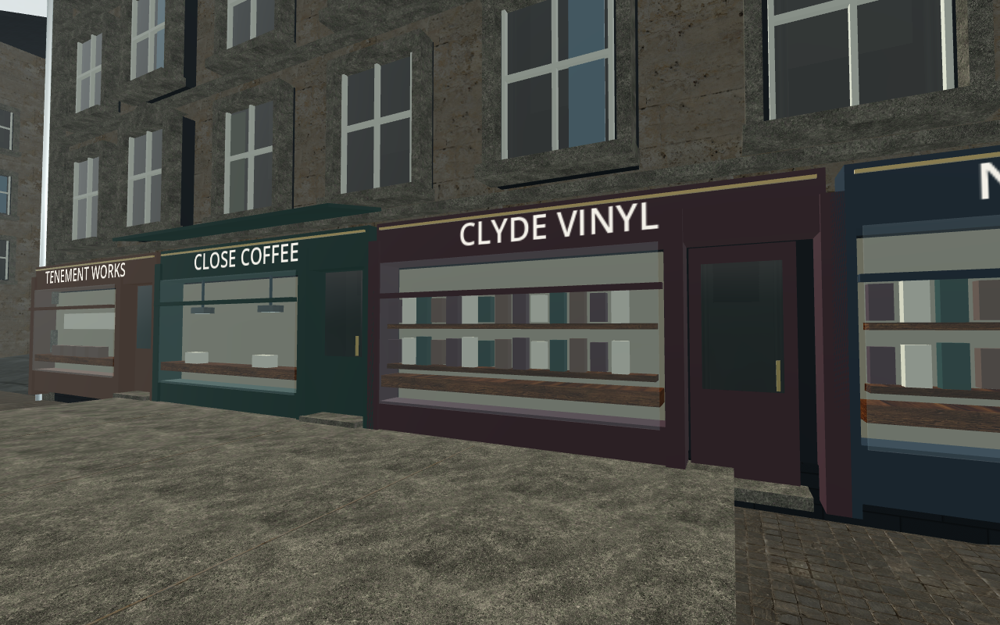
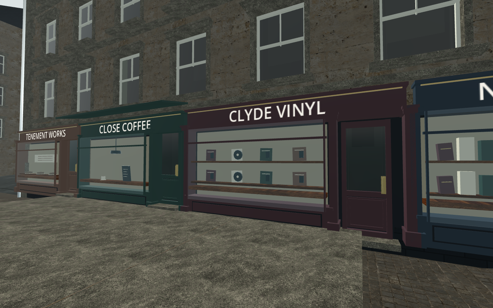
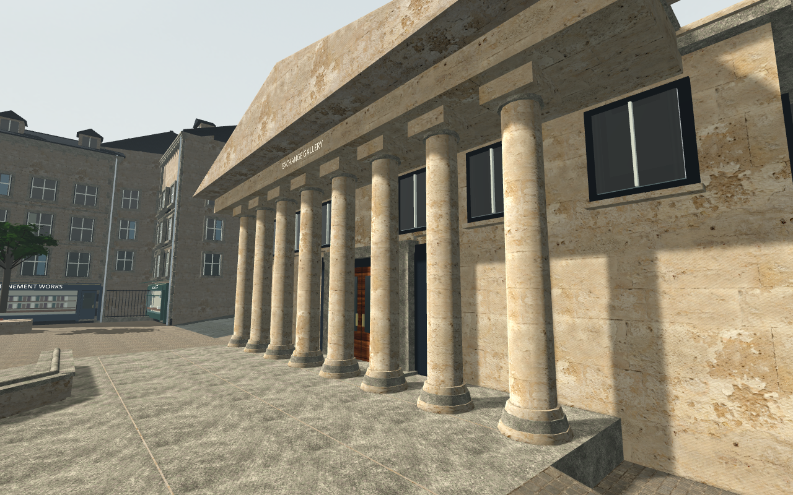
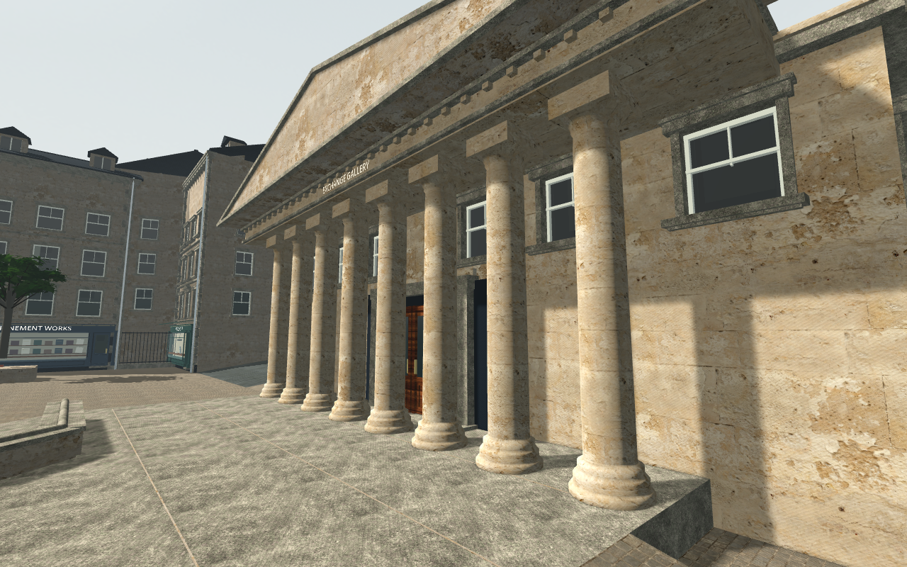

# Recessed architecture — matched private Main originals

**Private author trial; production art/tests remain unchanged.** Exact ordinary
Main original→V2→guarded-revert control completes **81/0 → 56/0 → 81/0**, with
21 original 1280×800 PNGs: four real views and three separate synchronization
proofs per phase. The [source-only contract adapter](../facade-contract-private-01/README.md)
is held fixed. [Independent QA review](independent-review.json) now passes158/0
and supports exact four-file/fixture integration followed by fresh combined
regression. Root's production release remains the coordination boundary.

The graphics copy refreshes the earlier frozen source to all 797 current
production inputs, including the actual coping changes in three geometry
modules/two tests and `tools/export.sh`. Only the reviewed private FacadeBay
adapter intentionally differs. The older successful headless snapshot remains
preserved separately. Each graphics phase has unchanged exact source inventories;
only the four candidate art modules differ between original and V2.

| Matched actual view | Original draws | V2 draws | Delta | Additional renderer buffer bytes |
| --- | ---: | ---: | ---: | ---: |
| Ordinary chase | 1,480 | 1,473 | −7 | 250,160 |
| Exchange shopfront | 894 | 898 | +4 | 250,160 |
| West upper oblique | 793 | 793 | 0 | 250,160 |
| Gallery column join | 1,043 | 1,027 | −16 | 250,160 |

Every original/restored-control draw, primitive, buffer and texture counter agrees
exactly in its matched view. Native process-local RenderingServer buffer delta is
**250,160 bytes (0.239 MiB)** in all four views, below the declared 4 MiB. Texture
allocation remains **95,006,369 bytes**, with the same 34 bound map resources.
Unique used materials change 114→113; the exact static shader/native moving-train
glass split, five retained eligible Box owners, eight column CPU records and
correct tangent upload pass their actual native guards.

The complete world source delta remains **+65,854 triangles / −7 mesh nodes**,
within the +80,000/+16 declaration. Actual all-pass rendered primitive deltas are
**+96,572 ordinary, +38,376 shopfront, +28,512 upper, +44,742 gallery**. These are
recorded separately; they are not the source triangle budget or a frame-time
result. Total draw increases at most four in the measured views, below +16.
On this GLES implementation, the viewport `VISIBLE` draw category includes
shadow passes; the reported `SHADOW` draw category is zero and does **not** mean
no shadows were rendered. Separate shadow primitive counters were not collected
by this observer. See the existing [native source interpretation](../../environment/shadow-counter-interpretation-addendum.json).

All canonical native collision records and exact route/grind/gap/terrain records
agree across the three modes; original/restored inventories agree completely.
Generated numeric Node-name suffixes are normalized only in the first collision
path field; all other native property bytes remain intact. The [comparison](comparison.json)
retains every raw counter and delta; the full engine-produced results are
losslessly gzipped with raw/compressed identities.

The architect personally inspected all 12 real-view originals and all nine
synchronization originals at native size. Door stiles/rails/panels, recessed sash,
record discs/books/cafe objects, smoother column bases/capitals and joined cornice
are clearer. Ordinary chase shows the foreground facade change. Full recorded
camera/player settings match across all three modes. The author integrity verifier
checks decoded RGBA8 identities, actual marker/Canvas pixels and declared resource
limits; its passing count is separate from independent acceptance.

| Original | V2 candidate |
| --- | --- |
|  |  |
|  |  |

The 21-frame cohort runs 04:34:30.405–04:42:57.166 UTC, **506.761 s**, with all
Godot/Xorg processes stopped before lease release. An earlier cold copied-project
check-only parser reached its short bound before any graphics; its rejected log
is retained. The retry parsed cleanly. Even including that earlier attempt/gap,
the complete work ends within the initially announced 600-second window. Capture
readback durations are not game FPS or pacing. Root-authorized short headless
diagnostics may overlap; this has no exclusivity/timing/global-VRAM claim. The
separately authorized QA 64-pixel witness actually starts after these processes
stop, so it has no overlap; exact bounds are in `overlap-scope.json`.

Remaining visual work is substantial: displays still have plain backs and sparse
stock, upper panes remain restrained, roofs and background masses repeat, and the
broader city/flatland composition needs the six-area moving review. These four
static angles do not verify moving shoulder/chase, every raised doorway/return,
all culling transitions, full regression, sustained pacing or MacBook Air M5.
This is a positive bounded resource/visual improvement, not AAA or whole-FID-203
completion. No new texture, material, light or collision change is introduced by
the four-file candidate.
