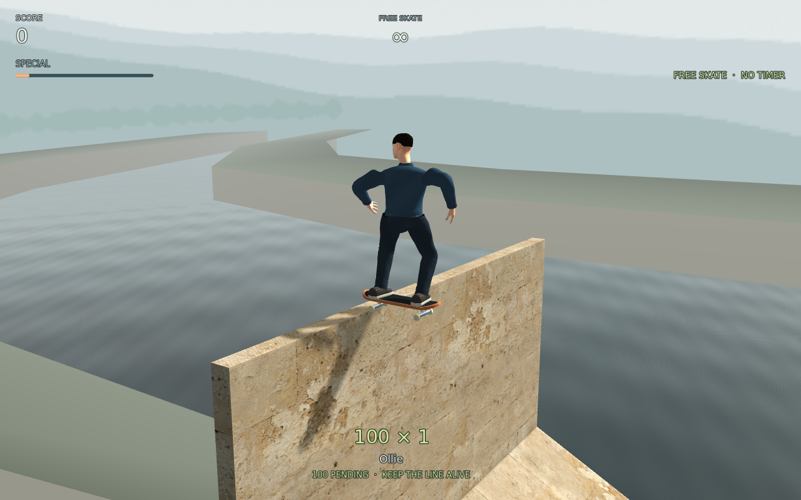
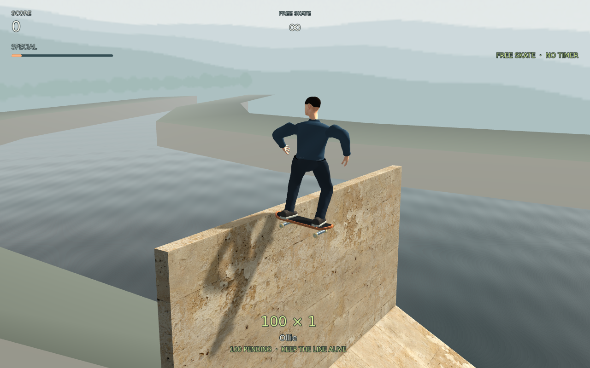

# Native bank crown motion — independent failure

**FID-D015/P1 remains open.** Native contact safety and visual continuity are
separate results. Both captures retain the full world, clean logs and unchanged
source bytes: side 492/0 with 32 consecutive physics frames; chase 314/0 with
three actual production-camera correction frames. All 45 exact original PNGs,
including synchronization, approach and landing, are in
[native-png-originals.zip](native-png-originals.zip). The
[index](native-archive-index.json) binds each original and decoded RGBA8 buffer.
The [full review](independent-review.json) records scope, activity disclosures,
source identity and the next reproduction.

The connected rider and deck move visibly sideways between side010 and side011.
A fixed dark blue shirt region shifts 28.627 pixels; the native presentation
offset changes 119.816407 mm in one physics step. The actual uncorrected mesh
intrudes 111.820 mm, so reducing the required 8 mm clearance is invalid. Motion
independently inspected the same originals and corroborates the step. Three true
chase frames are also retained; a camera along travel hides much of the lateral
displacement.

[The clip](bank-crown-60fps.mp4) contains 32 consecutive native frames at
1280×800, 60 fps and 0.533333 seconds. Every encoded frame decodes. It is ready
for normal-speed playback; this review inspects the original chronological frames
and does not invent human temporal acceptance. Fixed simulation playback does
not measure real-time rendering speed.

The fixture starts ordinary Main with all default content. Its only actor setup
sets initial position (66, 2.08, 73.5) and heading −PI/2 before settling 50 native
ticks. Ordinary Push, continuous steering and an 80.1 m gate with 16-tick charged
Ollie follow. No later actor, velocity or pose assignment occurs. The side camera
is authored; the full world, rider interpolation, production physics, lighting,
HUD and actual chase camera remain active. This standalone input reproduces the
same correction class without claiming identity with the preceding four-case
epoch. Three inherited camera, Canvas and native-pixel proofs run in each capture.

The copy has 789 equal source-before, source-after and copied production inputs.
Each capture adds its exact external observer and wrapper for 791 unchanged
inputs. Root's headless full suite intentionally overlaps; no exclusivity or
performance claim is made. Byte-identical main builder rewrites are disclosed
separately from source-byte stability. The private copy runs no editor import.

Next is a finite, earned-wall anticipation or contact-response repair, preserving
actual mesh, sole and capsule authority and foreign, stale, reset and landing
negatives. D012's native containment pass does not close D015. D014's separate
coping regression, combined checks, final art, export and main integration,
MacBook Air M5 and human review remain open.

