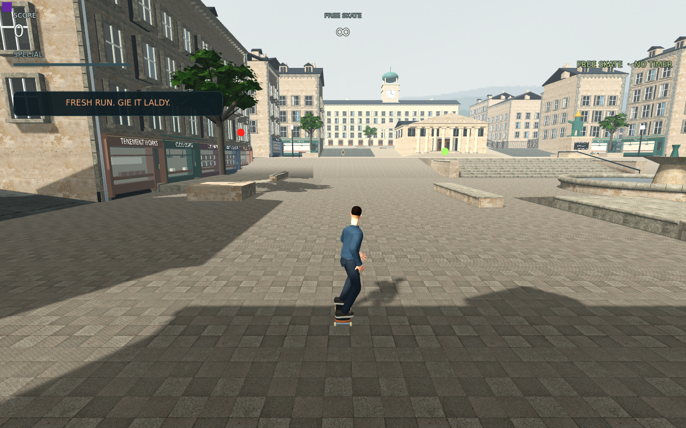
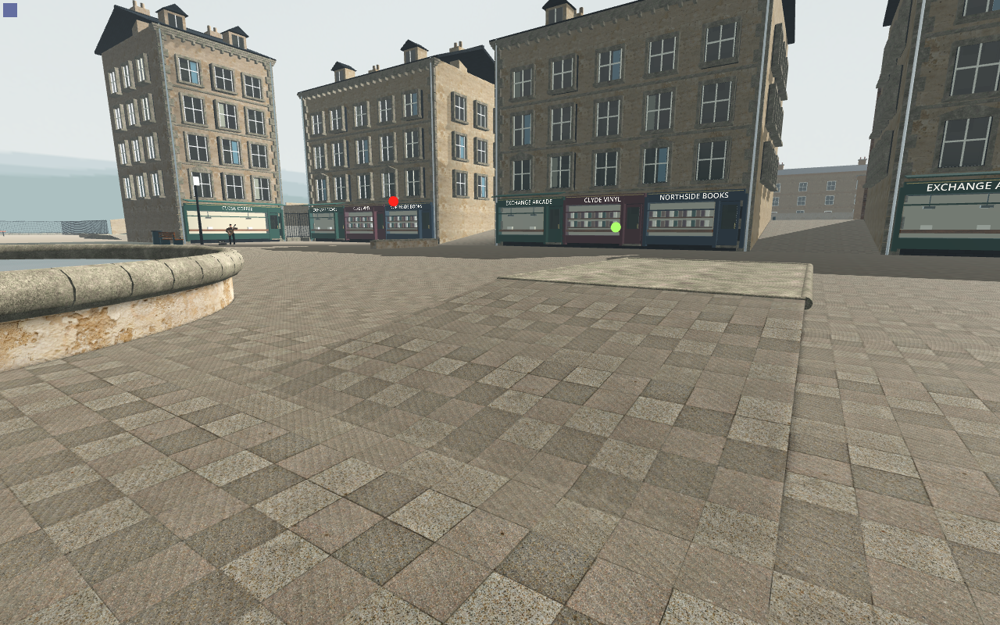
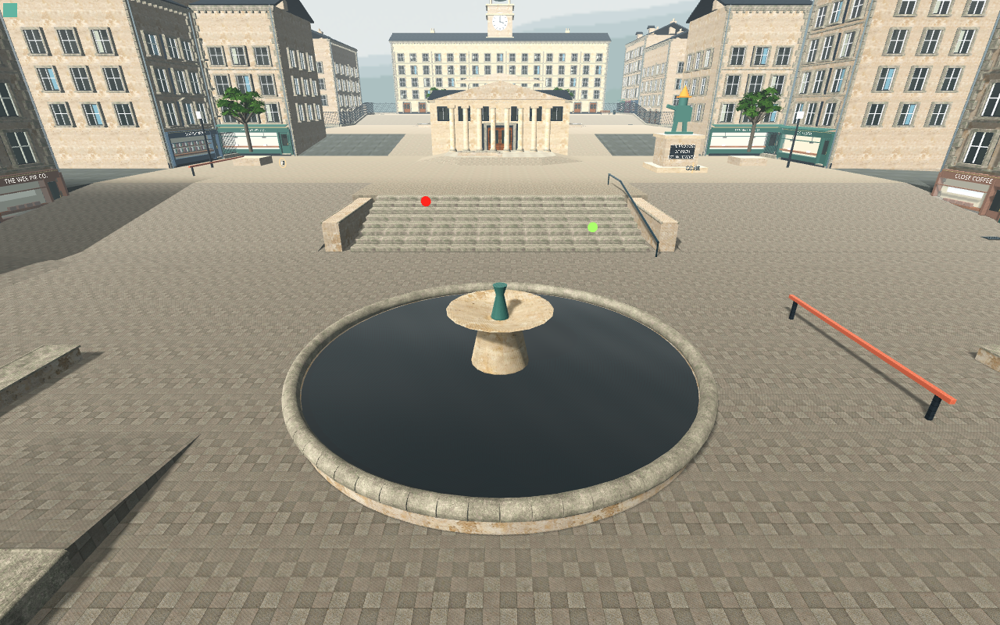

# Concrete02 actual Main — quieter joints, curved artifact unresolved

The nine A/B/A originals plus three synchronization frames complete **106/0**, clean and byte-stable on807inputs. The actual production chase/HUD, close bank and court are captured with full per-image nativeRGBA/camera/projection/tick/worldmarker/Canvas proofs.

Grey Concrete Pavement02 has thinner joints than the rejected bright-mortar setts; its alternating slab tones are still repetitive. Broad curved bands persist over the new rectangular texture. Direct review of both original albedos confirms the old pavement is also rectangular cobbles: the earlier 'photographic fan motif' attribution was incorrect. A separate rendering/lighting artifact needs controlled diagnosis. No source promotion or finish acceptance follows.

The separate [fresh resource proof](../concrete02-allocation-01/README.md) retains the15-map/+31.250384MiB budget. This visual bracket holds both source sets and cannot measure final resident resources. Candidate/restored draws and primitives match; initialcontrolA has a disclosed chase transient. No timing, normal-speed shimmer or M5 claim. [Analysis and attribution correction](analysis.json).
