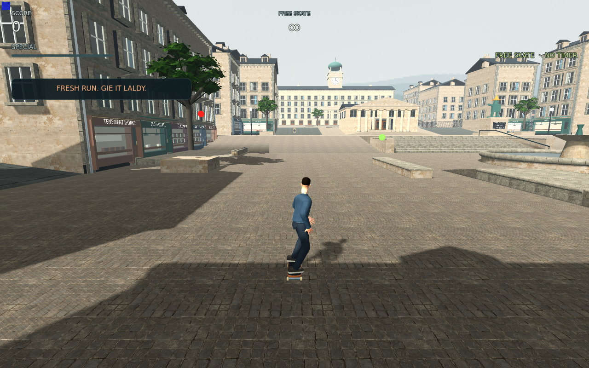
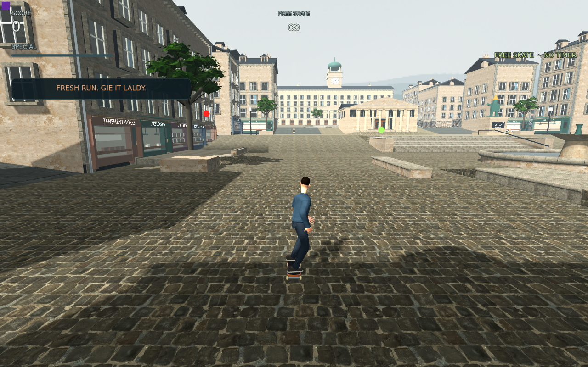

# Actual Main paving trial — raw setts rejected

**Capture integrity passes106/0 on801unchanged inputs. The raw setts candidate is rejected for final ground art; production remains unchanged.**

The exact same two shared paving/path material objects receive the CC0 Cobblestone Floor02 maps at their published2m width. Nine A/B/A views include the actual settled chase with HUD, a ground-level bank view and the court overview. Every view has native RGBA, full camera projection/basis/tick brackets, two projected world markers and Canvas evidence; three startup synchronization originals remain separate. [Native report](actual-main-paving-report.json), [source and scope](analysis.json).

| Existing fan paving | Raw setts candidate |
| --- | --- |
|  |  |

Fan arcs disappear, but much darker stones and bright mortar create a strong grid across the entire court. The surface dominates the composition in the chase and overview; it is not the restrained ground treatment required by the benchmark. The close view also exposes shared paving on raised bank sides, which must be included in material judgment. Passing provenance, allocation and capture checks does not accept that art tradeoff.

The separate component allocation pass remains valid for the declared fifteen compressed maps/+31.250384MiB. This visual process temporarily retains both control and candidate textures and does not establish final resident memory or frame rate. Actual compiled-cache copying is disclosed in [the cache policy](actual-cache-transfer-policy.json). A short root-authorized LD headless contact check overlaps; no timing, exclusivity, moving-surface, finalV2 or Mac claim is made.

Next is a quieter licensed shallow-joint grey paving source, with matched native review before promotion. The current fan material is retained until a better candidate passes that review.
