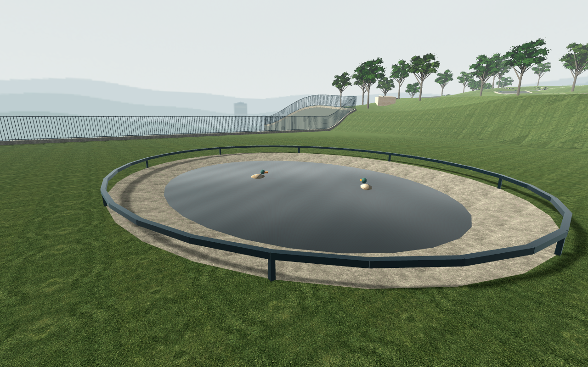
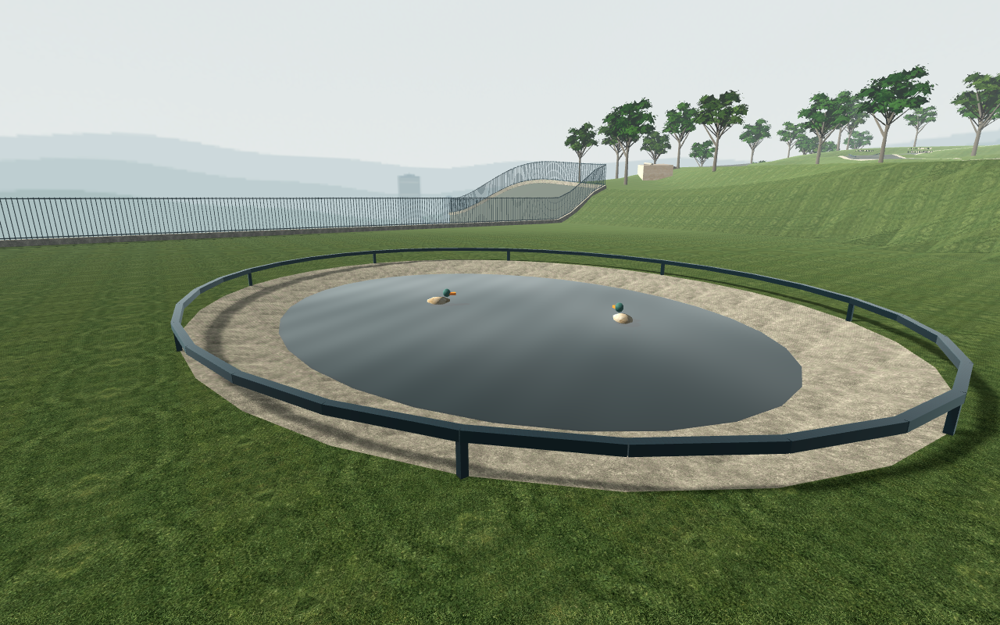

# Actual Main water casting trial

**Capture integrity and the narrow policy guard pass. Pond stills improve; fountain and river acceptance remain open. Production is unchanged.**

The exact current three-wave water shader and final Main sky are retained in default-enabled Main. Nine A/B/A originals plus three inherited natural-frame camera/Canvas synchronization proofs complete **60 native checks / 0 failures**, with **794 unchanged inputs**. A separate native negative guard passes **13/0**. Only the exact shared water shader selects casters; all non-water geometry, collision resources and sun settings remain unchanged. [Native report](actual-main-water-report.json), [guard](water-policy-guard.json), [scope and preservation](analysis.json).

| Pond baseline | Only water casting disabled |
| --- | --- |
|  |  |

The pond loses its fine comb bands while the directional bright response remains. The fountain still shows fine bands after the same three water casters are disabled. Its stone basin top lies approximately5mm below the water upper face, but that remains a hypothesis until a separate basin-caster control. The river camera points into the water bounds but the transfer bridge dominates the frame; it cannot establish river water quality. These limits prevent production promotion based on this packet.

Native shadow primitive deltas are32 for pond,274 for fountain (256fountain+18river) and18 for the bridge-obstructed river view; draw deltas are1,2and1. Water resources stay resident. Native shadow draw-call zero has the previously documented GLES accounting limitation and does not exclude shadow rendering.

Actors, gameplay processing and HUD are frozen/hidden equally for authored1280×800 still inspections. ShaderTIME remains active. Root-authorized short Motion/Rigging headless diagnostics overlap; there is no timing, sole-engine, normal-speed, finalV2 or MacBook Air M5 claim. The separate three-wave cost defect stays open.
