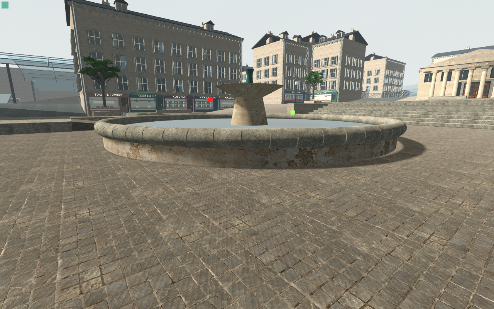

# Annular basin trial — exterior shadow defect remains

**Native geometry13/0 and actual Main capture88/0 pass. The top-only candidate fails exterior-shadow finish and remains private.**

The original256-triangle cylinder becomes a320-triangle mesh. Its192outer side/bottom triangles retain their indices, positions and UV;64hidden cap triangles become128annular triangles. The water seam differs by at most0.477µm, with zero measured projected footprint overlap. Native bounds, packing precision and unchanged collider guards are retained in [the geometry report](native-geometry-guard.json).

Nine A/B/A views plus three startup proofs are source-stable on798inputs, with per-view full camera/tick/marker/Canvas evidence. Water casting stays off and basin casting stays on in every frame. Fine fountain bands disappear; all other geometry/material/collision/sun resources remain guarded. [Native Main report](actual-main-water-report.json).

| Restored original | Top-only annulus |
| --- | --- |
|  |  |

The near right contact shadow becomes lighter and detached. In the declared ROI(1010,355)–(1120,415),772pixels differ, maximum88RGB8; every changed pixel is lighter. Exterior ground belowy440 is byte-identical. Missing inward-facing basin walls with one-sided shadow culling are a hypothesis requiring a controlled test. Casting flags alone do not prove the exterior shadow survives.

Candidate versus restored controlB has equal draws at all three views and64additional shadow primitives. InitialcontrolA has extra draws/primitives; that warm/culling transient prevents whole-bracket draw or cost claims. Original per-process counters remain unchanged. [Scope, exact pixel regions and preservation](analysis.json).

The original authoritative basin/pedestal cylinders, raised decorative/grind coping and water dimensions are unchanged. Production remains untouched. A revised private ceiling permits a credible hollow basin up to512source triangles,64KiB added native buffers and zero new nodes/materials/maps/lights/colliders; further evidence is required. Static warm captures do not close normal-speed shadows, water realism, shader cost or Mac performance.
