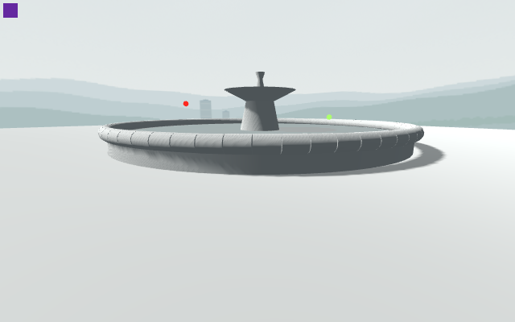
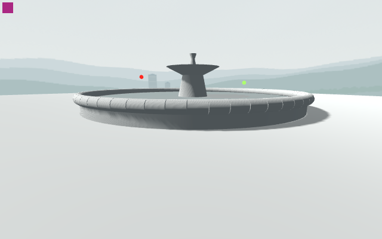

# Basin shadow culling control

**Four source-stable component originals pass55native checks. The shadow culling contribution is supported; this is not Main or final shadow acceptance.**

The exact source fountain/daylight/finalsky use flat native grey diagnostic receivers/displays at640×400. This removes costly photographic sampling after the earlier120-second attempt was rejected. Geometry, camera and opaque material cull/reception settings remain the same between controls. Every image has full camera/tick/independent marker/Canvas proofs. [Native report](basin-cull-report.json), [scope and pixel regions](analysis.json).

| Annular mesh, ordinary casting | Same mesh, double-sided shadow casting |
| --- | --- |
|  |  |

The detached light crescent substantially fills when only the casting flag changes1→2. Against the solid reference, the declared contact ROI falls from220changed pixels/mean8.527RGB8 to37pixels/mean0.417; the restored solid control is byte-identical there. A residual edge difference remains. The inspected GLES path explicitly disables culling for double-sided shadow casters.

This diagnoses missing facing surfaces; it does not justify a production double-sided workaround. A closed inward wall and floor must retain the real exterior/collider and pass actual Main seam/shadow review. No pacing, cost, cold-cache, normal-speed, water-realism or Mac claim is made.
