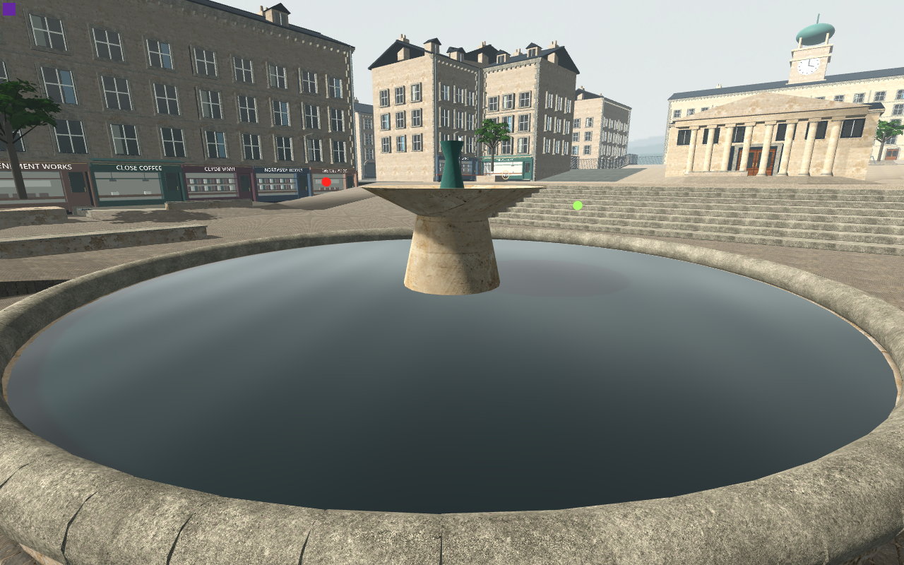
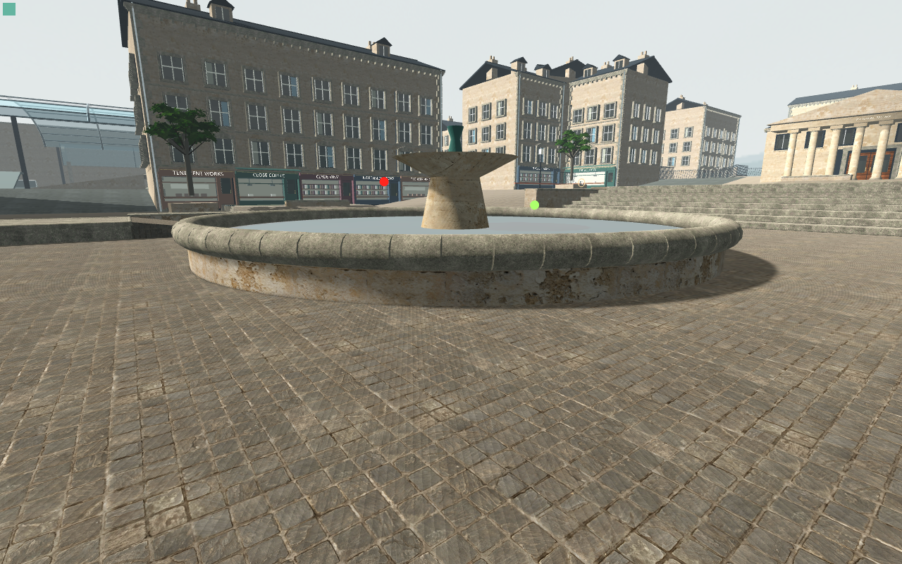

# Proper hollow basin — bounded Main visual result

Native Main capture **88/0**, clean and byte-stable on 799 inputs, nine A/B/A views plus three startup proofs. The exact 512-triangle closed hollow basin keeps its original exterior side/bottom and adds inward walls, upward floor and the visible annulus. Water casting stays off; basin casting and shadow reception stay on throughout.

The earlier detached contact-shadow crescent is resolved: ROI(1010,355)–(1120,415) and ground below y440 are byte-identical to the restored solid control. Fine fountain radial bands disappear in wide and close views. This is a static geometry/shadow result; broad water reflection, normal-speed temporal quality, shader cost and M5 performance remain open.

The separate [fresh-buffer proof](../closed-basin-buffer-01/README.md) measures **10,580 added bytes**, below64KiB; [geometry proof](../closed-basin-geometry-01/README.md) checks watertight topology/UV/tangents and preservation. Visual bracket resources coexist and cannot establish that allocation. Initial controlA has a warm/culling draw transient; candidate versus restoredB is matched. Exact sources, original pixels, per-image camera/tick/marker/Canvas proofs and scope are preserved. Promotion awaits independent review and ordinary integrated support/cohort verification.
