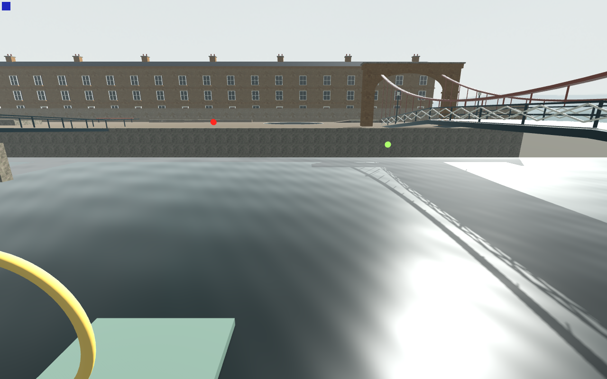
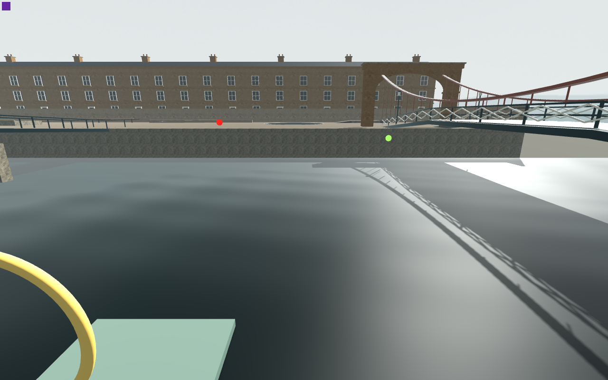

# Current Main three-/two-wave appearance — incomplete epoch, bounded pairs preserved

**The complete A/B/A epoch is rejected:** it reaches the unchanged360second limit with8/9target frames,3startup proofs and3shader warm states. Native86checks have no assertion failures, but `complete=false`; no whole-packet pass is claimed. All879private source inputs are stable.

Six primary A/B stills are complete: saved3wave4f5 versus installed2waved646 at current fitted Main river, fountain and pond, with two additional restored3wave river/fountain frames. The final restored pond is missing. Every completed target retains nativeRGBA/fullcamera/projection/tick/worldmarker/Canvas evidence and measured runtimecodeSHA. No runtime metadata is reconstructed. [Exact partial scope](completed-pairs-scope.json).

The sharedShader object is kept while its in-memory code changes; the on-disk resource remains installedd646. Recorded runtimecodeSHA distinguishes variants. Current512basin,three-waterOFFpolicy,native.1/2lights,allgeometry/material/collision/casteridentities and fitted actors remain fixed. NativeTIMEphases vary with wallclock, so snapshots do not establish normal-speed movement.

| Saved three-wave | Installed two-wave |
| --- | --- |
|  |  |

Personally opened all8contact originals: broad white riverglint reduces while bridge shadows remain; fountain/pond become darker and calmer but remain fairly flat opaque grey. The river coin is at the left edge rather than absent. Final water realism, completeA/B/A, cost admission and M5remain open. Rootrequiredheadless89810overlaps; no timing/FPS/CPUexclusivityclaim. The original240instruction was explicitly replaced by root’s unchanged360budget beforedeadline, with amendment preserved.
