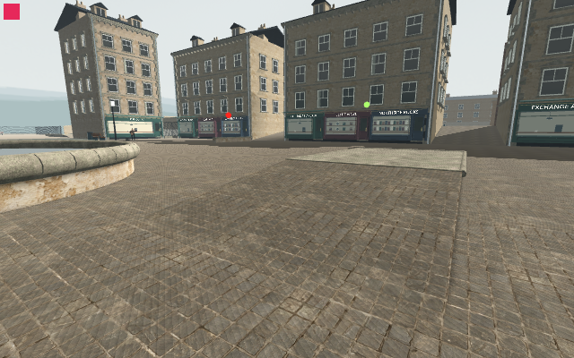

# Ground shadow controls — native bias removes curves with casters retained

The corrected six-mode640×400 Main observer completes **139/0**, clean and byte-stable on799inputs. Nine original images include three startup proofs and six same-camera controls with full nativeRGBA/projection/tick/worldmarker/Canvas evidence. The prior viewport-assertion failure remains [rejected and preserved](../ground-shadow-controls-01-rejected-viewport/README.md).

An actual unadded `DirectionalLight3D.new()` reports **shadow_bias0.1 /shadow_normal_bias2.0**. Restoring those values removes the broad curved bands from both flatcourt and raisedbank while every original caster, normal map and receiving shadow remains. The lower-bias .035/.55 restored control brings bands back. Sun-shadow-off also removes bands; disabling only the exact lower-court caster cleans only that court; normal-map-off leaves them. The phase1 lower-bias setting is the identified configuration regression, rather than a photographic fan pattern.

| Low explicit bias | Native defaults, all original casters retained |
| --- | --- |
|  |  |

Candidate/restored native resource and draw/primitive counters match; initialA has a disclosed warm/culling transient. This is qualitative640diagnosis, not FPS/cost/M5 or final contact-shadow acceptance. Source is the private pre-basin-install copy. Independent audit and full-resolution current-source basin/bridge/raisedbank contact views are still required before an actual lighting edit. [Exact scope](analysis.json).
