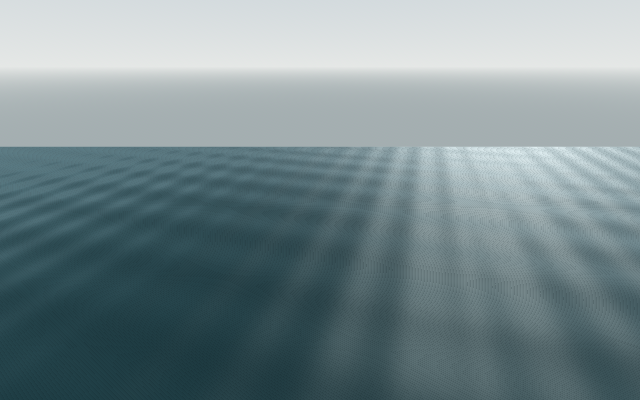
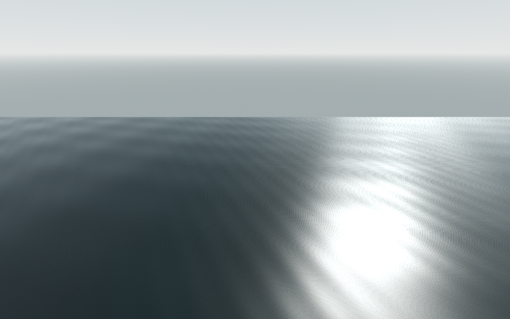

# Isolated water shader — epoch 01

**Capture integrity: pass. Cost admission: rejected for the high-coverage view; inconclusive for the other views. Final water quality and hardware performance remain open.**

The source-frozen native process completed all nine declared A/B/A cells and six original 640×400 previews, with 31 checks / 0 failures and no engine errors. [Original receipt](receipt.json), [native raw report](isolated-water-report.json), [interpretation](analysis.json). The observer invoked the exact production water-plane and daylight functions without constructing Main. It measures a component workload, not full-world 1080p performance.

[Independent QA review](independent-review.json) verifies all preservation hashes, six decoded native RGBA8 buffers, 784 unchanged source inputs, 50 process-observer samples, every raw-cell sample count/duration and all percentile/resource calculations. It awards bounded capture-integrity PASS and retains the cost rejection.

| View | Before A / candidate / before B median, ms | Interpretation |
| --- | --- | --- |
| River oblique | 20.458 / 20.727 / 25.276 | Controls drift; inconclusive |
| High coverage | 58.608 / 66.751 / 46.096 | Candidate exceeds both controls; cost cell rejected |
| Grazing | 59.906 / 24.580 / 23.754 | Controls drift strongly; inconclusive |

The high-coverage candidate also exceeds both controls at p95 and p99. Do not average this failed view away. The before/after controls vary substantially, so the experiment cannot establish how much of the difference is caused by the shader. All cells retain **2 draws / 4 primitives, 14,736,405 texture bytes and 7,443,628 buffer bytes**. The host observer sampled every second and found no competing Godot process; the rider specialist confirmed its offline fitter was idle. Shorter processes and host scheduling remain outside that observation.

The environment specialist opened all six original previews. Broad parallel bands soften and the sky response is calmer, but bright glint and fine stipple/striation remain. Native shader TIME differs between modes; these pictures cannot approve temporal shimmer or normal-speed gameplay motion. Fine striation also appears with zero native shadow draws, weakening the earlier caster-artifact hypothesis.

| Historical high-coverage shader | Candidate high-coverage shader |
| --- | --- |
|  |  |

Exact executed observer/runner, both shaders, production function snippets, source inventories, native camera/pixel records and process log are retained. A later stronger-warmup or cheaper-shader experiment must create a separate epoch; this cell remains rejected.
