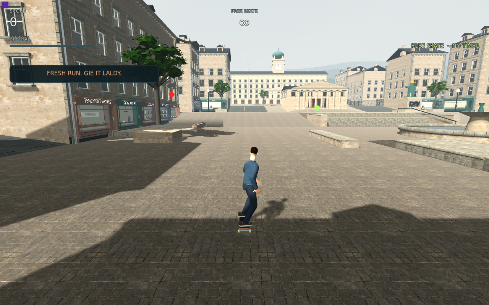
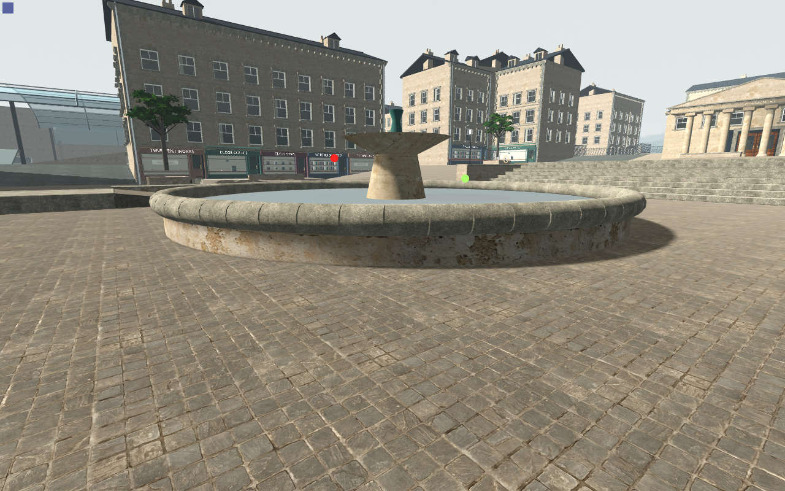

# Full-resolution current-source lighting contacts

The native1280×800 comparison completes **136/0**, clean and byte-stable on803inputs, with **18contact originals plus3startup proofs**. Six views each have low-biasA /actualnative-default /restoredA: production ordinarychase/HUD, groundbank, basin exterior, bowl, shopfront and unobstructed river/bridge. Full per-image nativeRGBA/camera/projection/tick/worldmarker/Canvas proofs are retained.

The exact installed512basin and three-water caster policy are constant across all frames. Only two sun values change: explicit .035/.55 versus actual public DirectionalLight getters .1/2. Every enabled caster, all scene shadow reception and all native geometry/material/collision identities remain. A read-only whole-game comparison differs from actual source only by the two generatedhelperUIDmetadata files, absent in the private copy.

Candidate versus restoredB draw/primitive/shadowprimitive/native memory counters match in all six views. InitialcontrolA has retained chase/basin warm/culling transients; no timing, FPS, soleCPU or M5 result is inferred. Authorized private headless overlap is retained separately.

Independent full-resolution contact/source/proof review is required before the surgical two-field actual lighting change. This is frozen still evidence; moving feet/contact, water realism and overall AAA acceptance stay open. The current three-wave river remains harsh grey/white in places; the cheaper two-wave shader and its cost admission are separate. [Exact scope](analysis.json).
