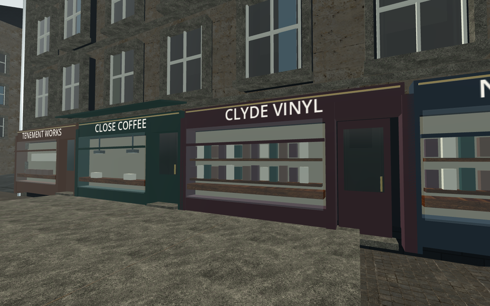
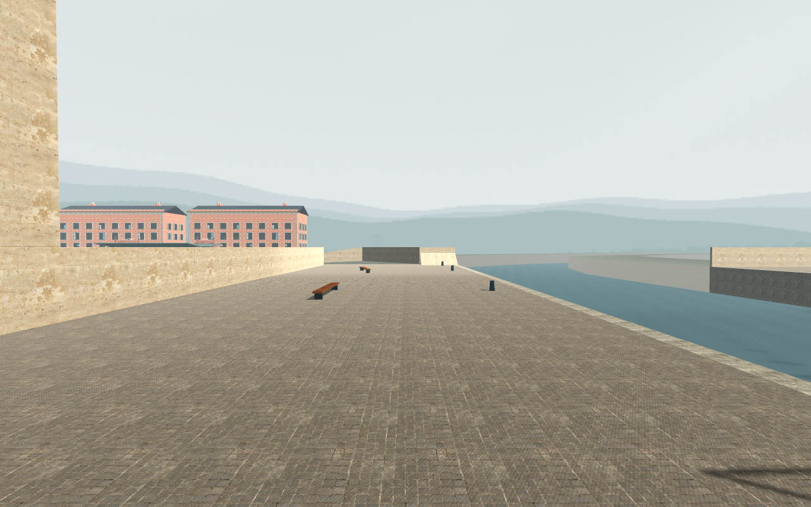
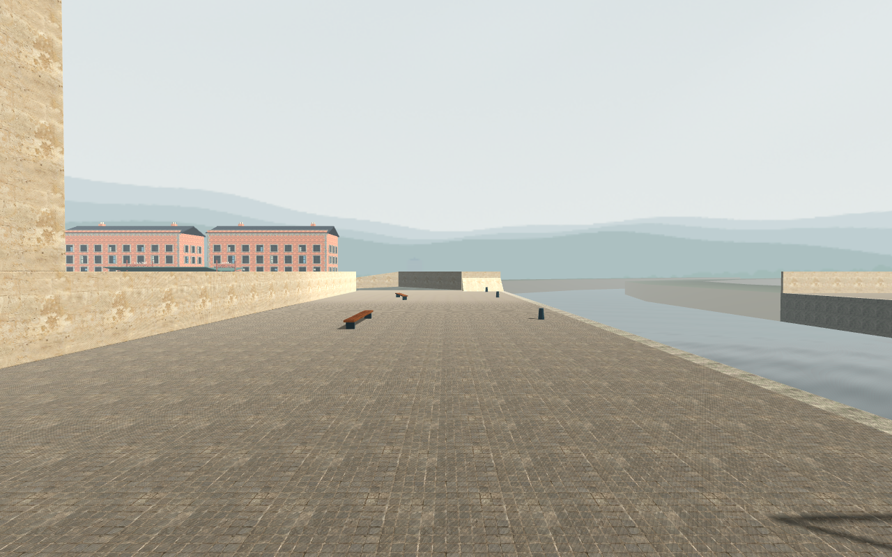

# Native environment subsets

The complete full-world water workload is **incomplete/rejected**: [original receipt](receipt.json), exit −15, `eligible=false`. Its input inventory remained stable and no engine error was logged. Parent-directed interruption avoided hours of software-renderer sampling. No water timing cell completed.

The earlier fresh native allocation process **completed successfully**: [exact report](texture-report.json). It measures **31.250384 MiB additional surface textures**, within the original 32 MiB declaration, with unchanged 8 draws / 96 primitives in its isolated grid. [Independent QA audit](../../environment-allocation-independent.json) awards **allocation-only PASS**.

[Completed-subsets receipt](completed-subsets.json) states the limits of each retained subset. All 43 original lossless PNGs are retained, byte-matched against the original wrapper hashes. Per-frame runtime cameras, native pixel hashes and synchronization records were not flushed by the interrupted Main stage and remain unavailable. Source-declared camera fixtures are not relabelled as measured runtime metadata.

The six normal originals received positive bounded static review from the environment specialist and independent QA; they do not establish moving-surface or hardware acceptance. A close example:

| Exact 2K normal reference | Production 1K normals |
| --- | --- |
|  |  |

The partial water stills show a visible reduction in the thin parallel band pattern. Shader TIME differs between modes; these are authored camera diagnostics, not normal-speed gameplay playback:

| Historical water shader | Candidate water shader |
| --- | --- |
|  |  |

Fine fountain striation, regular paving repetition, architectural dressing, full-world water cost, temporal stability and MacBook Air M5 acceptance remain open. The shader-only 640×400 follow-up has its own scope and cannot close those full-world/hardware gates.
