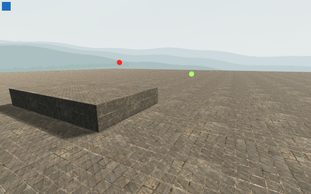
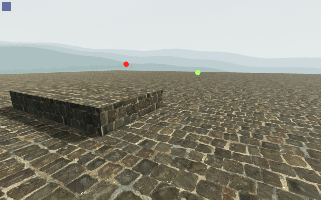

# Paving candidate — native component

**Resource control passed. Main readability and final art decision remain open. Production is unchanged.**

The candidate replaces the three pavement maps with the unchanged CC0 **Cobblestone Floor 02** photographs at the provider's **2 m** width. Native imports retain 2K albedo and 1K normal/packed AO-roughness. [Independent provenance/rebuild review](../paving-provenance-candidate-01/independent-review.json) verifies the creator, licence, three downloads and deterministic policy.

A separate fresh native allocation process measures **15 unique compressed maps**, **31.250384 MiB additional surface allocation** within the original 32 MiB ceiling, and unchanged **8 draws / 96 primitives**. [Allocation report](paving-allocation-01/texture-report.json). This process does not construct Main or measure frame time.

Nine matched component A/B/A originals pass **70 native checks / 0 failures**, with current camera, red/green world marker, Canvas and RGBA8 proofs. [Visual report](paving-visual-01/visual-paving-report.json).

| Existing fan paving | Worn setts candidate |
| --- | --- |
|  |  |

Fan arcs disappear and stone courses become clearer. Candidate mortar is brighter and more contrasty, and the units are larger at the documented physical scale. Those tradeoffs require the actual Main chase/court review; this component alone does not close repetition, composition, landing readability or V2.

The plane and ledge are declared inspection fixtures. Baseline and candidate textures temporarily coexist in the visual process, so its memory is not the final production resource result. The fresh allocation above owns that separate claim. No timing, moving-surface or MacBook Air M5 acceptance is implied.
