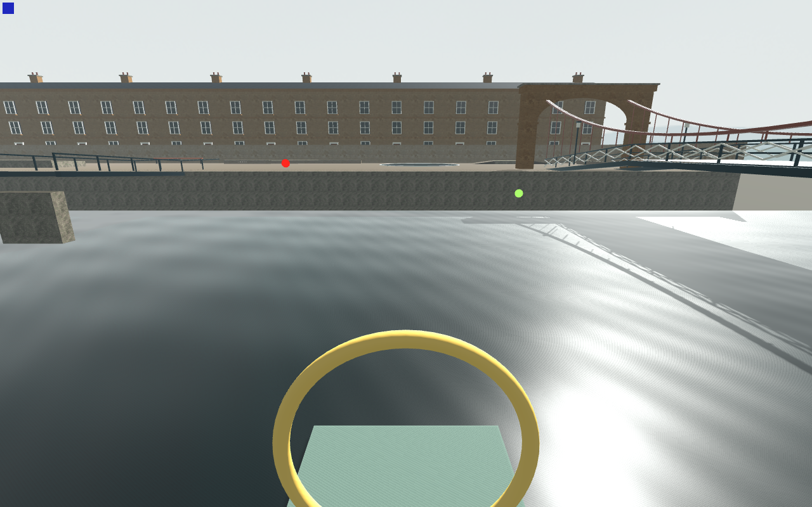
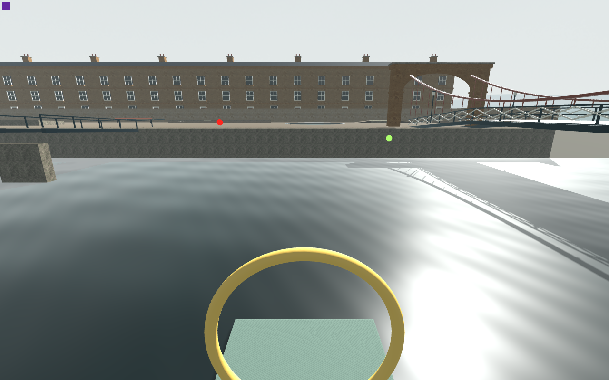
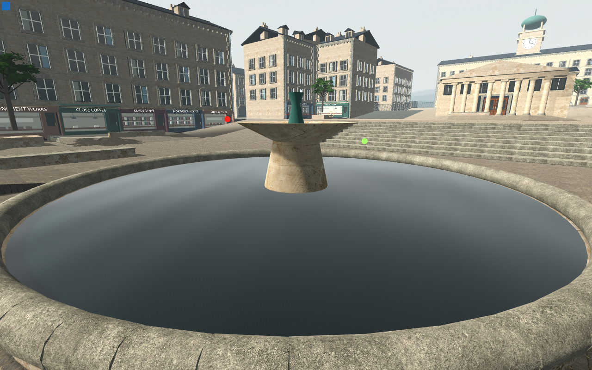
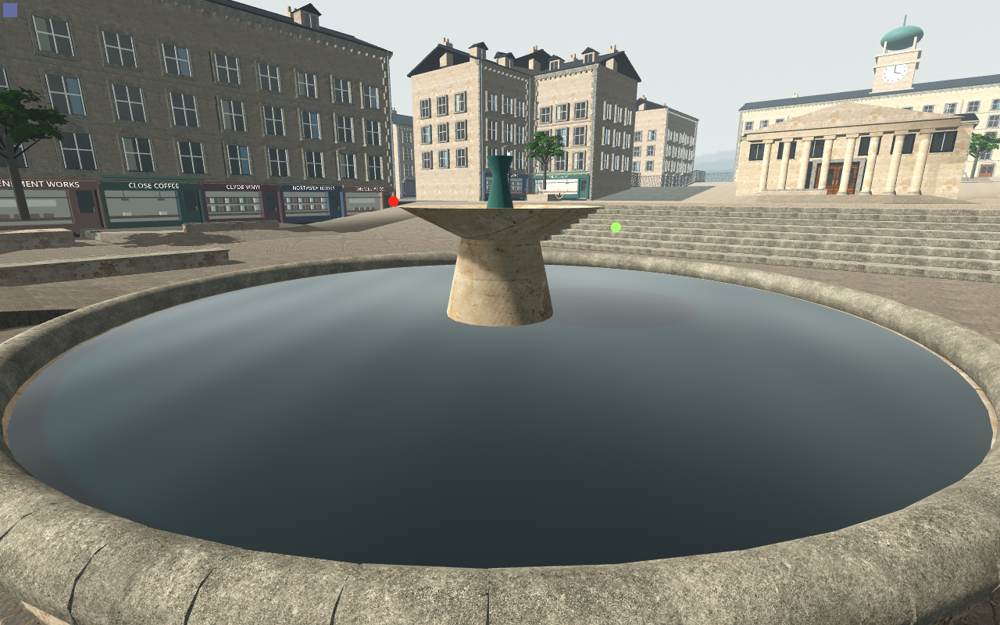

# Actual Main river and basin shadow diagnosis

**128 native checks /0 failures;795 unchanged inputs. Causal still-image evidence, no production correction or cost acceptance.**

Nine A/B/A originals each retain two independent projected world-marker centroids, a current Canvas sample, full camera basis/projection/aspect/near/far and native physics/process brackets. Three startup synchronization originals remain separate. The exact final Main sky, ordinary enabled content and current three-wave shader are retained. [Native report](actual-main-water-report.json), [scope and preservation](analysis.json).

| Unobstructed river, original casting | Only shared water casting disabled |
| --- | --- |
|  |  |

The measured centre sightline clears the actual three bridge deck world bounds. The river loses its fine comb bands while true bridge shadows and broad directional reflection remain; bands return in the restored control. The ordinary pickup occupies part of the lower foreground, without hiding the broad water view.

| Water casting off, basin casting on | Water casting off, only basin casting off |
| --- | --- |
|  |  |

Both fountain cameras fix water casting **off in all three controls**. Disabling only the native stone basin caster removes the remaining fine radial bands; restoring it returns the bands. Other non-water casters, sunlight, shadow reception, native resources and all collision remain unchanged. Native bounds establish a solid visual basin ending atY0.55m, overlapped by waterY0.545–0.555m. Its hidden full cap is a separate shadow source. A proper visual correction should retain the basin's exterior shadow and authoritative collision rather than globally disabling stone shadows; no correction is installed here.

Matched native shadow primitives are river50873→50855→50873; fountainwide201134→200878→201134; fountainclose188556→188300→188556. These are geometry observations, not frame-time results. Actors are frozen and shaderTIME is active. Independent renderer-cache copying is disclosed; no cold launch, exclusivity, normal-speed, finalV2, Mac or three-wave cost claim is made.
