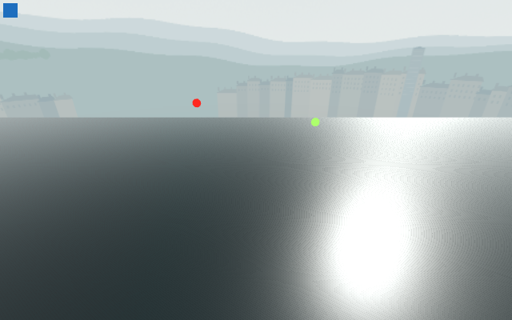
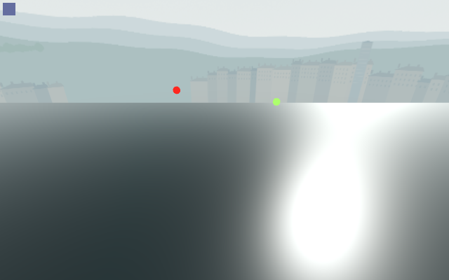

# Water casting control

**Component evidence supports a water-specific casting fix. Actual Main and temporal/cost acceptance remain open.**

The exact production water plane, ordinary-Main horizon sky and native PBR values are retained. Nine matched originals pass 58 native checks. Independent QA verifies 108 checks, including all source/pixel hashes, 18 projected markers, nine Canvas samples, matching cameras and the actual per-mode flags.

| Baseline water casting | Only water casting disabled |
| --- | --- |
|  |  |

Disabling only the plane's casting removes the fine striation while sun shadows, reflection, fog and ACES remain enabled. Native shadow primitives fall from **2 to 0**, draws from **5 to 4**, with identical texture/buffer allocation. Disabling the sun's shadows also removes the bands, but changes the reflection more. This is a controlled shadow-path result; no wave shader or global renderer change is needed to explain this component defect.

The GLES shadow draw-call counter remains zero in both cases because of its inspected accounting limitation. That zero cannot exclude real shadow work. [Source interpretation correction](../shadow-counter-interpretation-addendum.json), [native report](visual-water-report.json), [interpretation and preservation hashes](analysis.json).

Every displayed image is a full native 640×400 original. The small red/green world markers and corner Canvas swatch are diagnostic frame proofs. No timing or sole-engine claim is made. Receiving shadows and all non-water render/resource states need separate actual-Main guards before promotion; the three-wave cost rejection remains a different open gate.
