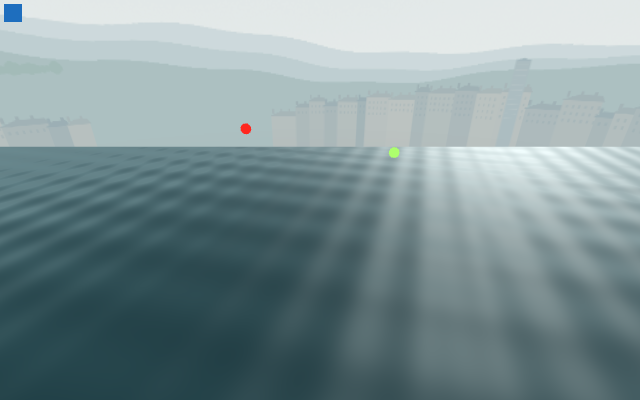
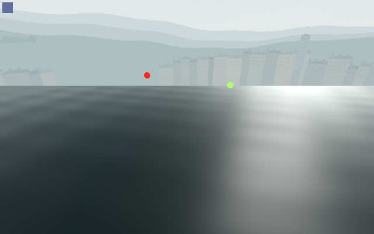

# Two-wave27-cell diagnostic — integrity passes, cost gate remains open

Native **67/0**, clean and byte-stable on802inputs, with27timing cells and6proof previews. All407host samples show only the owned native engine85315; zombie82100 is separately retained. This proves bounded capture integrity, not a clean performance pass.

**High-coverage repeat2p99 is60.335ms versus31.013/31.238ms controls (+93.15%).** Five of27candidate percentile comparisons exceedboth controls, including two oblique median regressions of3.77%/2.13%. All nine p95s are below the slower control, and high-coverage/grazing medians improve; those positive subsets cannot erase the failed tail. Control tails also drift sharply, so causal shader attribution remains uncertain. [Complete comparisons](candidate-control-comparisons.csv), [scope and recommendation](analysis.json).

The exact original admitted2phasefixturee60 is compared with the proposed2phased646, using the finalnative.1/2bias profile, actualMaincontextsky and one exact900×38sourcewaterplane. Both modes cast no shadow. Three repeatedA/B/A brackets for eachofthree views rotate vieworder, warm48frames and sample≥48naturalframes/≥3seconds. Readbacks are outside timing. Every cell has raw intervals/camera/resource data; preview pixels have full camera/tick/worldmarker/Canvas proofs.

All27cells retain1draw/2primitives,14,736,405native texture bytes and7,451,468buffer bytes. No Main/rider/basin/finalriverassembly or targetMac performance is measured. Three transient Python process observations are retained; CPU exclusivity is not established. No live competingGodot was observed at.25s polling intervals.

| Original admitted fixture | Proposed two-wave material |
| --- | --- |
|  |  |

Personally inspected allsix previews: the candidate is calmer and less repetitively striped; broad white reflection persists. This does not directly compare currentMain3wave with2wave, or certify normal-speed motion. A provisional ordinary-trial replacement can be considered with all cost/final-water/M5gates explicitlyopen. Independent raw-data/proof review is required. The earlier failed3wave/highcoverage and rejected PID-only startup epochs remain preserved.
