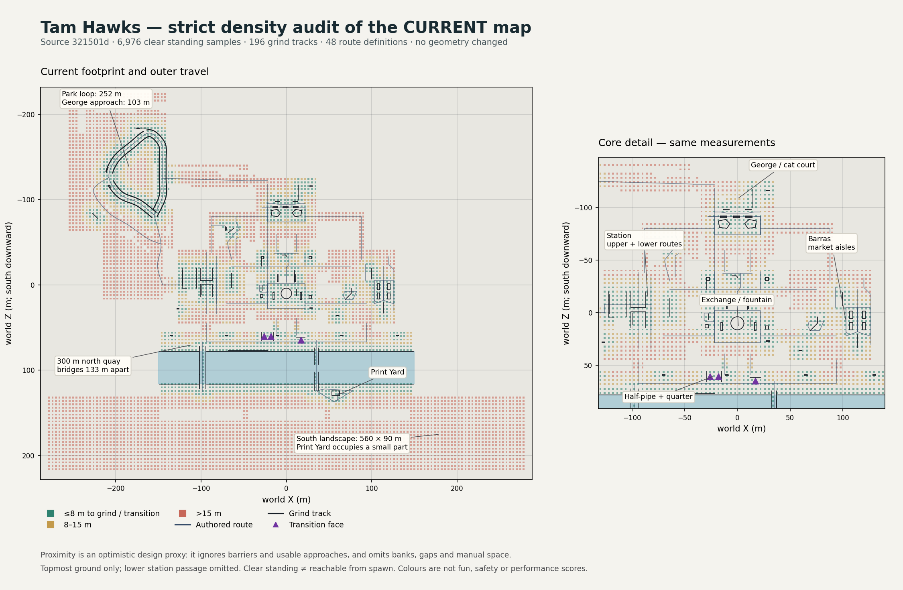

# Current-map density evidence — 18 October 2026

This is a read-only spatial inventory for the [strict design review](../../levels/STRICT-DENSITY-REVIEW.md). It changes no game geometry or tuning. The current map has a large outer footprint around concentrated local features; neither the existing regression count nor the 196 registered grind tracks proves that travel between those features is interesting.



[Full-size PNG](current-layout.png) · [SVG with rasterized sample layer](current-layout.svg) · [measurements](metrics.json) · [execution receipt](receipt.json).

## Evidence and limits

The Godot 4.6.3 Compatibility exporter constructs the actual `GlasgowSquare` World and reads its public route, grind, transition, goal, checkpoint and encounter definitions plus authored terrain. It does not create Main, play a career run, modify a profile, or invent a new floor. The sole engine process exits 0 with a clean [log](inventory.log). All **346 accepted game/asset/test/tool/project inputs** match before and after, and match the preceding accepted 2,041/0 check. That regression was **not rerun** for this documentation-only review; its evidence remains [source-bound history](../arcade-response/final-check/receipt.json).

The 4 m grid tests a 0.28 m radius / 1.7 m high upright capsule with 60 mm sole clearance against collision layer 1, then requires a downward ray within 0.1 m of the published topmost terrain height. This yields **6,976 potentially standing samples**. The samples do not establish connectivity from spawn, camera clearance, successful tricks or exact accessible area. The lower station passage is omitted wherever higher terrain covers it. The test is deliberately too coarse to certify tiny gaps or every surface.

For each point, Python computes the minimum **3D distance** to every registered grind polyline and to the exact authored cylindrical transition strips. Colours use review thresholds of 8 m / 15 m; these are **not** the controller's capture radii. The proxy ignores barriers and approach directions, and does not count ordinary banks, stairs, named gaps, manuals, NPCs or visual interest. Close proximity can overstate usefulness; a distant rail does not make a good bank or run-up worthless. Do not relabel the percentages below as a percentage of “dead map”.

| Source measurement | Result | Design implication to investigate |
|---|---:|---|
| Physical south landscape bounds | 560 × 90 m | A very large roamable-looking apron surrounds a small yard. Reclassify surplus as bounded scenery. |
| Physical north quay | 300 × 23 m | Concentrate the river's actual destinations rather than populating its full length with filler. |
| Bridge X separation | 133 m | Test a much shorter return circuit between safe crossing and optional gap. |
| George–park promenade, 3D polyline | 103.04 m | Shorten the approach while retaining park identity and a clear junction. |
| Station–park climb, 3D polyline | 84.36 m | Grade variation alone does not guarantee interesting travel. |
| Park rolling loop, 3D polyline | 252.42 m | Keep its best switchbacks and terrace connections in a smaller pocket. |
| All standing samples >15 m from grind/transition | 4,520 / 6,976 (64.8%) | A conservative spatial warning; not a fun or accessibility score. |
| South landscape samples >15 m from grind/transition | 2,822 / 2,871 (98.3%) | Strong reason to inspect this outer expanse first; slope and yard use are separate evidence. |
| Registered grind track kinds | 146 ledges, 25 rails, 16 curbs, 9 copings | Track count includes segmented physical edges; it is not 196 distinct combo lines. |
| Transition faces | 3 faces in 2 local arenas | One half-pipe and a separate quarter; not three separate destinations. |

The 148 m `exchange_fountain_loop` route is an outer rectangular tour, **not** the circular fountain coping length. The north-quay route is 232.20 m while the physical quay is 300 m. Route lengths include all supplied 3D polyline segments. `metrics.json` also divides those lengths by illustrative constant 8 / 15 m/s speeds; these values are **not recorded player travel times** and omit acceleration, turns and grades.

Actual visual judgement uses the preceding [41 rendered current images and native-input traces](../arcade-response/area-current/manifest.json), whose 346 executed inputs still match this inventory. The design agent inspected all 41. Those are bounded traversals, not continuous human exploration of every square metre. The review separates recorded travel from inferred design quality and proposed targets.

## Reproduction and retained artifacts

The [independent final audit](audit.json) verifies source/artifact hashes, all 48 route lengths, image decoding, links and preservation of the 75 full records. Its [audit code](audit.py.txt) is retained.

The exact executed [exporter](export-layout.gd.txt), [analysis](analyse.py.txt), [compressed raw inventory](live-layout.json.gz), [before](source-before.json) / [after](source-after.json) hashes and [receipt](receipt.json) are retained. Run from the repo root, serially with all other Godot/render/Blender jobs stopped:

```sh
mkdir -p .local/level-density
cp docs/testing/level-density/export-layout.gd.txt .local/level-density/export-layout.gd
./tools/run.sh --headless --script .local/level-density/export-layout.gd
```

This emits `.local/level-density/live-layout.json`. Compare raw counts and definitions to the retained inventory. A **new** source snapshot and start record must be prepared for a new run; do not reuse the old receipt as new execution evidence. The analysis expects `.local/level-density/source-before.json`, `started.json` and `export-final.log` as recorded by the orchestrator. Its literal `321501d` / 346 assertions describe this checkpoint and must be updated for future source. It uses installed NumPy and Matplotlib, with caches under `/tmp`; it is evidence code, not a new runtime or test dependency.

No performance workload ran here, and no FPS, target-Mac, physical-controller or human-fun result is claimed. [Implementation tasks](../../planning/LEVEL-DENSITY-NEXT.md) must validate layout changes with actual controls and matched rendering before admission.
